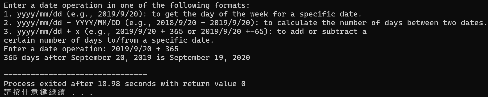

# Assignment I：日期運算

[課程首頁](../../README.md) · [全部報告圖片](RESULTS.md) · [逐檔索引](FILES.md)

## 目的與問題

將日期轉換成可計算的資料，支援星期查詢、兩個日期的天數差，以及指定日期前後若干天。重點是把 Gregorian 曆法規則、輸入資料表示與運算邏輯分離，理解「資料結構簡單」不代表邊界條件簡單。

適用概念包括排程、期限計算、紀錄時間分析及測試資料日期產生。這是教學用 Gregorian 日期工具，不是含時區、夏令時間、歷史改曆或時間戳記的完整日期函式庫。

## 程式與資料表示

主版本：[Programming_Assignment_I.c](src/Programming_Assignment_I.c)。`date` 結構含 `year`、`month`、`day` 三個整數。月份天數由表格取得，再依閏年修正二月。

| 操作 | 設計 | 複雜度與性質 |
| --- | --- | --- |
| 閏年判斷 | 可被 400 整除，或可被 4 整除但不可被 100 整除 | O(1) |
| 星期查詢 | Zeller congruence，調整一、二月的年份與月份 | O(1) |
| 日期差 | 將日期累積成自第 1 年起的天數，取絕對差 | O(Y)，Y 為年數範圍 |
| 日期位移 | 往前／後跨越月界，修正年、月、日 | 與跨越月數相關，不是固定 O(1) |

`total_days` 逐年累加，沒有使用封閉公式。`date_sub` 輸出絕對天數，因此前後日期對調不會得到負值。

## 操作流程

1. 讀取一行輸入並取得第一個日期。
2. 檢查第一個日期的月份與天數合法性。
3. 沒有運算子時，輸出日期名稱與星期。
4. `+` 後接天數時，進行日期位移；負天數表示往回走。
5. `-` 後接另一日期時，輸出兩日期的絕對天數差。

## 編譯與範例

在 repository 根目錄執行：

```powershell
gcc -std=gnu11 assignments/assignment01-date/src/Programming_Assignment_I.c -o build/date.exe -lm
'2019/9/20' | .\build\date.exe
'2024/2/28 + 1' | .\build\date.exe
'2024/3/1 + -1' | .\build\date.exe
'2018/9/20 - 2019/9/20' | .\build\date.exe
```

預期分別包含 `Friday`、`February 29, 2024`、`February 29, 2024`、`365 days`。程式每次處理一行，並非可連續下多個指令的互動 shell。[examples/operations.txt](examples/operations.txt) 收錄可分次輸入的例子。

## 結果與分析

本次重跑五個日期案例，包括正反向閏日、跨年日期差與拒絕不合法的 `2023/2/29`，結果符合檢查預期。這證明指定案例的曆法處理可正常工作，沒有涵蓋所有年份及整數極值。

報告保存 18 張圖，包含原程式輸出與外部網站日期工具的對照。後者只是當時的交叉查核畫面，**不是本專案開發的網站功能**。



圖示為原報告的日期位移結果；比較圖及其他天數見完整圖片索引。大幅位移時，跨月實作通常比每天逐一加減更有效率，但目前的日期差仍須逐年累計。

## 限制與可改善方向

- 第二個日期沒有與第一個日期同等完整的合法性檢查；`sscanf` 的成功欄位數也未全面檢查。
- 輸入行緩衝區約 40 bytes，長輸入、格式錯誤與超大天數並非安全處理範圍。
- `%04d` 只表示至少四位數的顯示格式，不是「最大年份 9999」的程式保證。
- 超大年份可能造成累計天數溢位；負年份與歷史 Gregorian 施行差異不在模型內。
- 報告畫面的整體執行時間可能包含等待輸入，不能視為純日期演算法的微秒級基準。

若發展為可重用函式庫，應加入一致的日期驗證、明確的可表示年份範圍、解析錯誤回傳與更完整的測試，再考慮 O(1) 的日序換算。
