# Assignment I：完整報告圖片

[作業說明](README.md) · [程式索引](FILES.md)

本頁收錄原 Word 報告內的 18 張圖片。依媒體檔編號排列，該順序不保證等同 Word 的閱讀順序；不是本次驗證工具的新截圖。圖中文字、時間與測試資料均屬歷史紀錄，解讀請配合作業 README。

PNG 可直接檢視；SVG 另提供向量連結，不將向量與 PNG 重複版本算成額外獨立測試。

## 圖 01：日期程式的歷史操作與結果

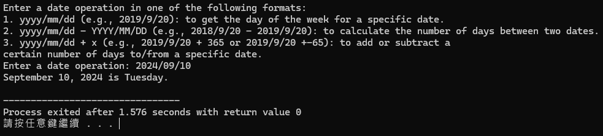

## 圖 02：外部日期工具的歷史對照截圖（非自行開發介面）

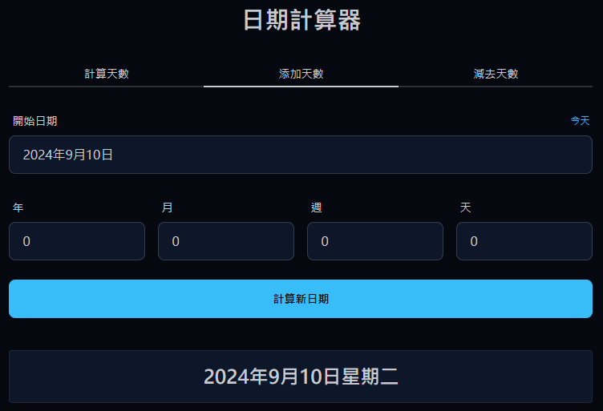

## 圖 03：日期程式的歷史操作與結果

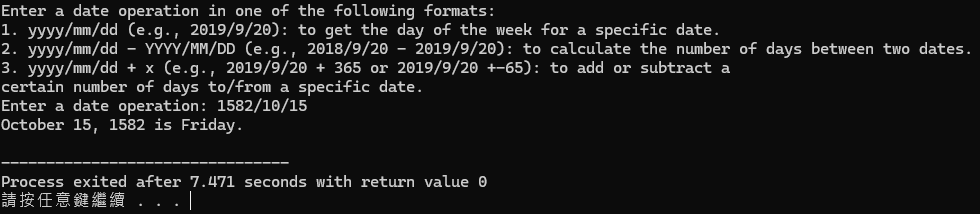

## 圖 04：外部日期工具的歷史對照截圖（非自行開發介面）

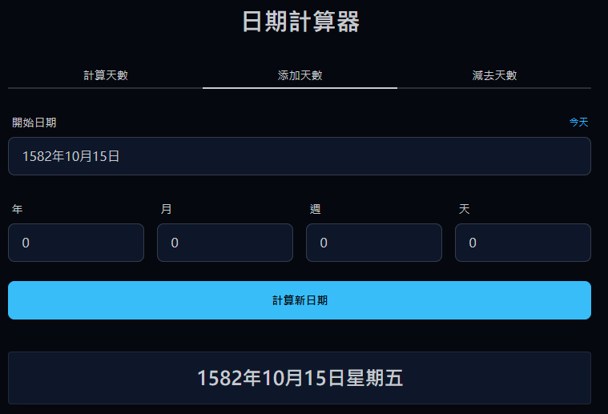

## 圖 05：日期程式的歷史操作與結果

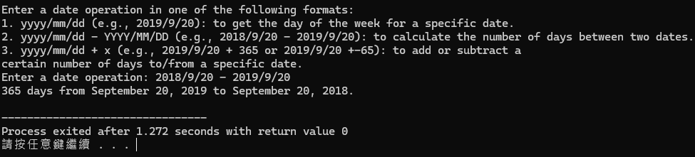

## 圖 06：外部日期工具的歷史對照截圖（非自行開發介面）

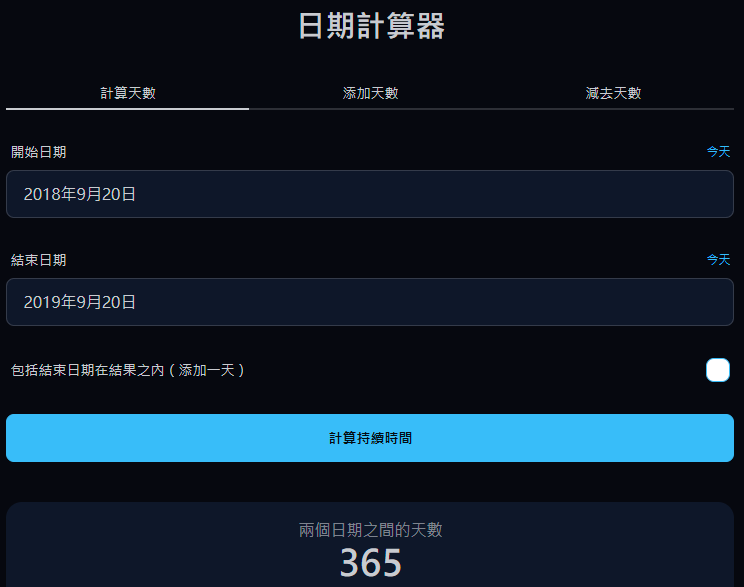

## 圖 07：日期程式的歷史操作與結果

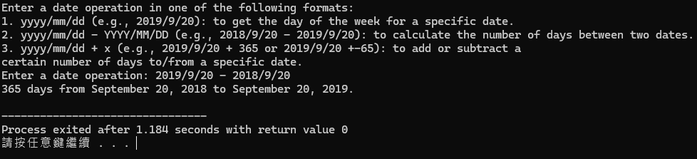

## 圖 08：外部日期工具的歷史對照截圖（非自行開發介面）

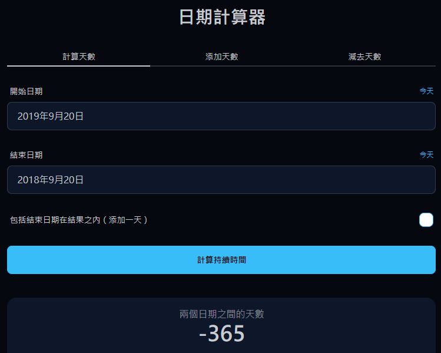

## 圖 09：日期程式的歷史操作與結果

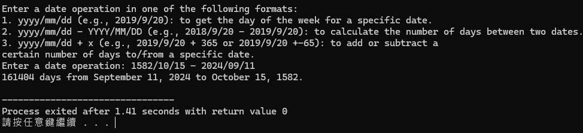

## 圖 10：外部日期工具的歷史對照截圖（非自行開發介面）

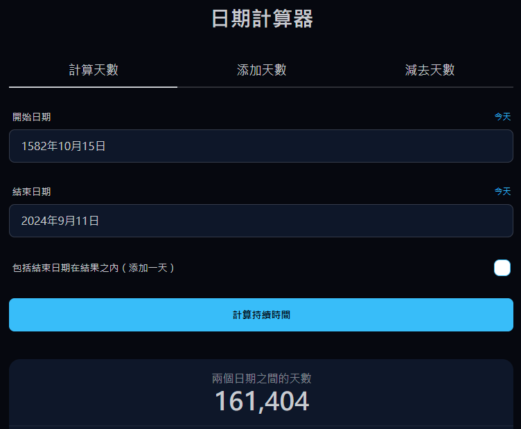

## 圖 11：日期程式的歷史操作與結果

## 圖 12：外部日期工具的歷史對照截圖（非自行開發介面）

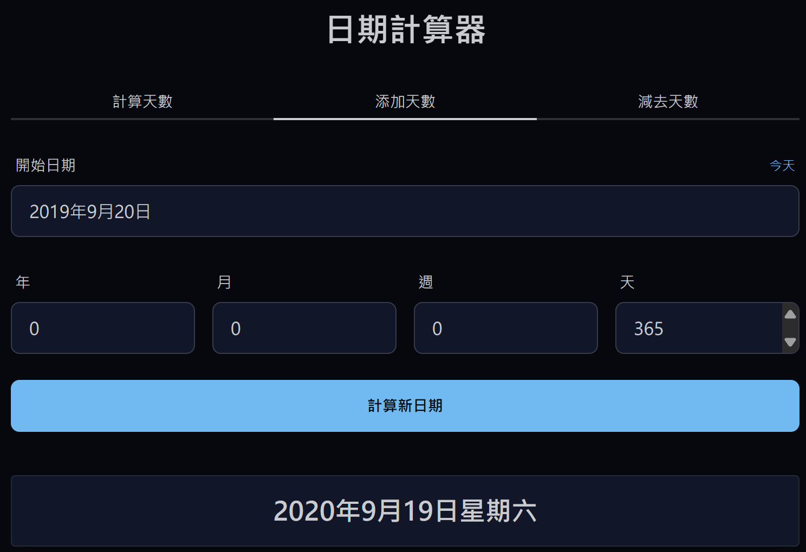

## 圖 13：日期程式的歷史操作與結果

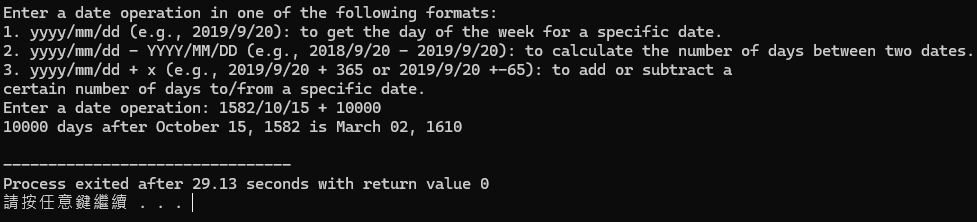

## 圖 14：外部日期工具的歷史對照截圖（非自行開發介面）

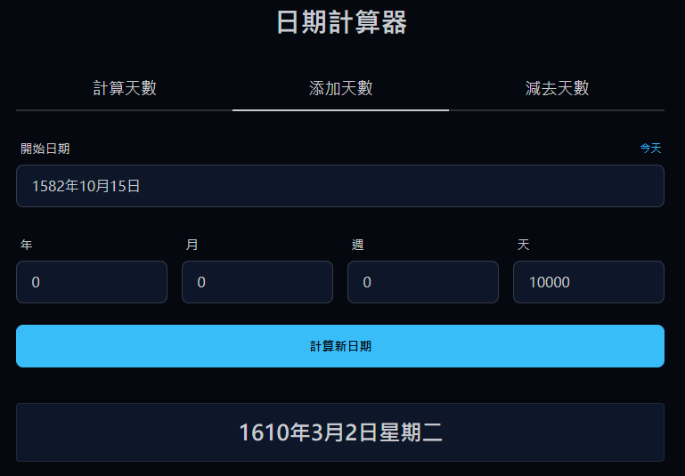

## 圖 15：日期程式的歷史操作與結果

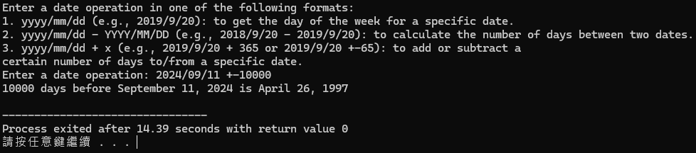

## 圖 16：外部日期工具的歷史對照截圖（非自行開發介面）

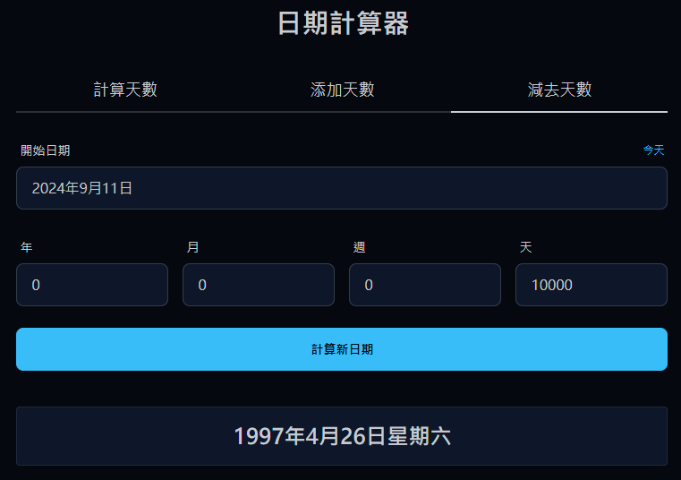

## 圖 17：日期程式的歷史操作與結果

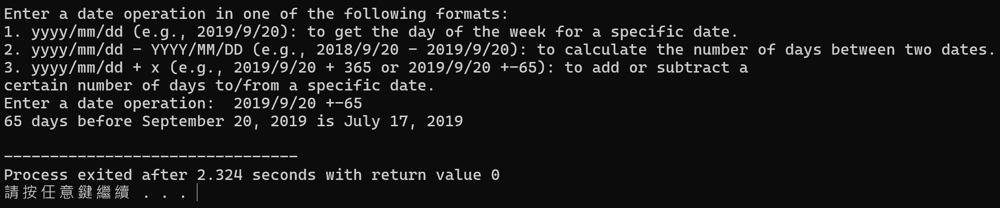

## 圖 18：外部日期工具的歷史對照截圖（非自行開發介面）

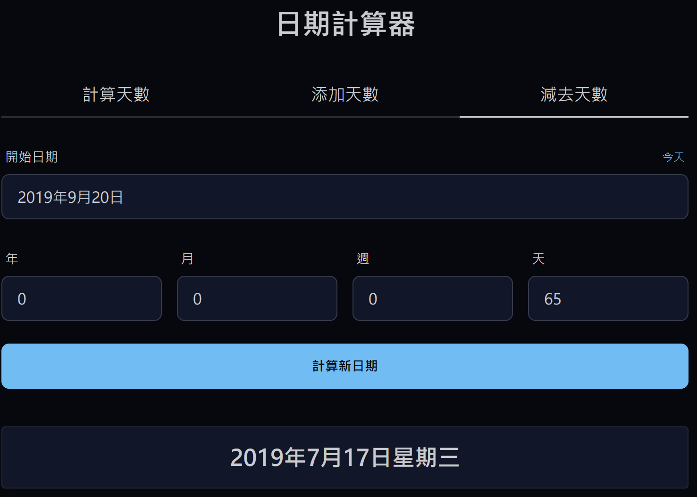
