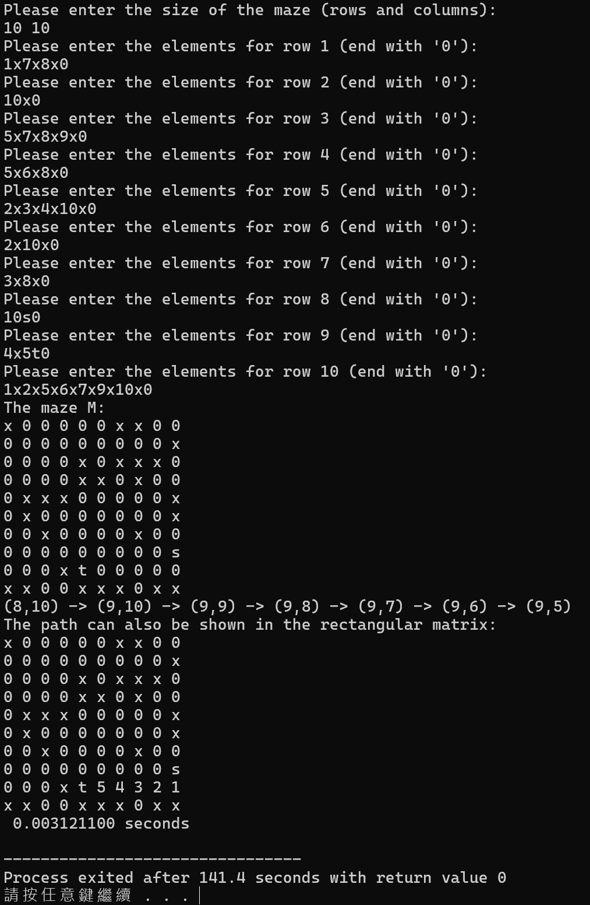

# Assignment III：BFS 迷宮最短路徑

[課程首頁](../../README.md) · [全部報告圖片](RESULTS.md) · [逐檔索引](FILES.md)

## 目的與用途

將二維迷宮轉成隱含的無權重圖，透過 Breadth-First Search 找起點到終點的最少移動步數。練習佇列、visited 標記及 parent 回溯，理解搜尋過程與最後路徑是兩種不同資訊。

適用於等成本網格移動、遊戲路徑、簡化機器人地圖及連通性分析。如果不同格子的通行成本不同，BFS 不再保證最低成本，應改用 Dijkstra 或其他加權搜尋。

## 資料結構與輸入

主版本：[Programming_Assignment_III.c](src/Programming_Assignment_III.c)。先配置動態字元矩陣讀資料，再複製到最大 10 × 10 的靜態迷宮；佇列容量 100，與最多格數一致。

- `s`：唯一的起點；`t`：唯一的終點；`x`：不可通過的障礙。
- 未指定的格子初始化為 `'0'`，視為可通過。
- 第一行是列數與欄數；之後每列輸入 `欄號 字元` 配對，以單獨的 `0` 結束。
- 外部座標及欄號採 1-based；內部陣列採 0-based。

範例 [maze.in](examples/maze.in)：

```text
4 5
2 x 0
2 s 4 x 0
3 x 0
2 x 4 x 5 t 0
```

## BFS 流程

1. 找出 `s` 與 `t`，起點進入 queue 並標記 visited。
2. 每次 dequeue 一格，依右、下、左、上的順序檢查四個鄰居。
3. 對合法、未走訪且非障礙的格子記錄 parent，在 enqueue 時即標記，避免重複排入。
4. 到達終點後，沿 parent 鏈回到起點，反轉成前進路徑。
5. 列印路徑座標，並將迷宮中的路徑格改成步序標記。

BFS 以層次增加距離，因此首次抵達終點即為最少邊數路徑。有多條等長路徑時，鄰居順序決定目前顯示哪一條。

## 結果與複雜度

本次 4 × 5 案例得到：

```text
(2,2) -> (2,3) -> (1,3) -> (1,4) -> (1,5)
      -> (2,5) -> (3,5) -> (4,5)
```

共 8 個頂點、7 條移動邊，不應將節點數直接稱為步數。另以 `s x t` 的 1 × 3 迷宮確認不可達時輸出 `No path found`。

最多每格入隊一次，每格檢查四個鄰居，時間及 visited／parent／queue 空間都是 O(RC)。動態矩陣仍被複製到固定 10 × 10 陣列，因此不是任意大小迷宮實作。



原報告另有多種大小與障礙配置，完整五張圖見圖片索引。圖上歷史耗時包含程式內部分初始化、搜尋與輸出工作，不是獨立測量的純 BFS 核心成本。

## 編譯與操作

```powershell
gcc -std=gnu11 assignments/assignment03-maze/src/Programming_Assignment_III.c -o build/maze.exe -lm
Get-Content assignments/assignment03-maze/examples/maze.in | .\build\maze.exe
Get-Content assignments/assignment03-maze/examples/unreachable.in | .\build\maze.exe
```

## 限制與分析

- 必須輸入合法且唯一的 `s`、`t`。缺少端點時，端點座標可能未初始化；本版沒有可靠的錯誤防護。
- 解析器對欄號檢查上限 10，而不是實際輸入欄數；輸入欄號大於已配置寬度可能造成越界。
- 路徑圖以 `'0' + 步序` 產生單字元；步序超過 9 後會出現標點，不是多位數數字。座標清單較適合確認長路徑。
- 不包含斜向移動、地形權重或多起終點模型。

若擴充用途，應先修正端點／欄號驗證、改用整數路徑矩陣，再將尺寸與 queue 改為動態容量；避免只把 MAX 值放大卻忽略其他固定配置。
