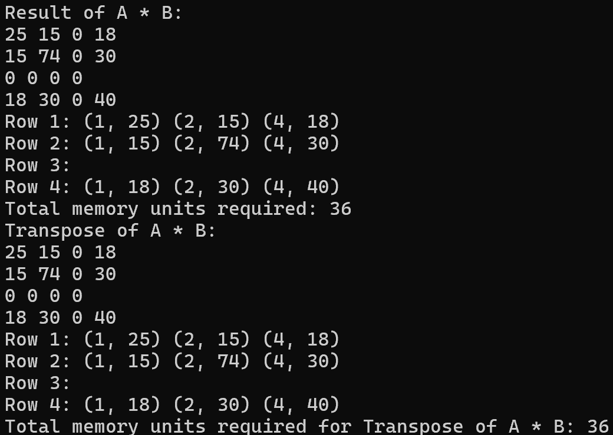

# Assignment IV：鏈結串列稀疏矩陣

[課程首頁](../../README.md) · [全部報告圖片](RESULTS.md) · [逐檔索引](FILES.md)

## 目的與應用

以逐列的 Linked List 儲存非零項，避免為大量零值配置完整二維陣列，並實作矩陣加法、乘法與轉置。目標是理解資料表示如何影響記憶體與運算流程，而非只用一般陣列完成相同計算。

稀疏矩陣概念常用於圖的連接關係、科學計算與離散模型。本作業的逐列串列方便增添節點及教學觀察，但不等同於高效能數值函式庫的 CSR／CSC 格式。

## 程式與表示法

主版本：[Programming_Assignment_IV.c](src/Programming_Assignment_IV.c)。每個 `Node` 含欄索引、數值與下一個節點指標；矩陣以 `rowList` 存放各列起點，另外記錄 `m`、`n`。

```text
rowList[0] -> (col=1, value=1) -> NULL
rowList[1] -> (col=1, value=1) -> NULL
```

上例表示矩陣 `[[1,0],[1,0]]`。外部輸入的欄索引採 1-based。程式以密集格式列印矩陣，並另外列印各列串列供檢查；因此輸出時仍會走訪零值位置。

## 輸入與運算流程

先輸入 A 的列數與欄數，再逐列輸入 `欄號 數值`，以單獨 `0` 結束該列；之後以相同格式輸入 B。欄號應遞增且不重複，因為主版本直接附加節點，沒有先排序或合併重複欄位。

1. 建立 A、B 並顯示原矩陣與串列。
2. 分別建立兩矩陣的轉置。
3. 維度相同時進行加法，合併對應列的已排序串列。
4. A 的欄數等於 B 的列數時進行乘法。
5. 顯示結果、結果轉置及程式估算的 memory units。

目前主版本提供**加法、乘法、轉置**，沒有獨立的減法介面。不可因題目提到加減法而將未實作的操作列為已完成。

## 演算法與複雜度分析

| 操作 | 實際實作 | 成本與限制 |
| --- | --- | --- |
| 加法 | 每列雙指標合併 | 已排序且合法輸入下，O(m + nnz(A) + nnz(B)) |
| 乘法 | 遍歷結果位置，利用 A 的非零項查找 B 的對應列 | 串列查找與結果附加仍有額外成本；不能僅因資料稀疏就宣稱必然線性 |
| 轉置 | 將 `(row,col)` 交換後附加到新的列 | 若每次附加都重新找尾端，單列累積成本可能達平方級 |
| 儲存 | 每個保留項一節點，加上列起點陣列 | O(m + nnz)，但零值結果可能仍被保留 |

加法遇到相反數相消時沒有自動移除零節點。因此此結構實際儲存的項數不一定等於數學上的非零項數；這會影響空間與後續乘法效率。

`calculateMemoryUnits` 以一個節點 4 units、每 unit 4 bytes 的模型估算，將 64-bit pointer 算成 2 units。它**不是完整的實際記憶體量測**，未涵蓋列指標陣列、矩陣結構、配置器 overhead 等，也不應當成任意平台的 `sizeof(Node)` 保證。

## 可重現結果

[matrices.in](examples/matrices.in) 使用：

```text
A = 1 0       B = 0 2
    1 0           0 2

A+B = 1 2     A*B = 0 2
      1 2           0 2
```

本次重新編譯後，指定加法與乘法輸出均符合預期。程式同次執行會列出轉置；該輸出保留在驗證 JSON，但自動測例沒有逐一驗算每個轉置元素。

原報告包含 33 張圖片，涵蓋不同大小的矩陣、加法、乘法、轉置與維度不符的情況。



此圖為原報告的較大型案例，不是上述新加入的 2 × 2 測例。結果圖與記憶體 units 應配合原輸入閱讀，不能把所有畫面的矩陣混為同一筆實驗。

## 編譯與執行

```powershell
gcc -std=gnu11 assignments/assignment04-sparse-matrix/src/Programming_Assignment_IV.c -o build/sparse.exe -lm
Get-Content assignments/assignment04-sparse-matrix/examples/matrices.in | .\build\sparse.exe
```

## 已知限制與改善方向

- 無完整排序、去重、欄號與輸入格式驗證；請使用遞增、合法的欄號。
- 相消零值仍存於節點，未維持嚴格的「只存非零」不變量。
- 乘法與轉置未維護高效的查找／尾指標，不適合直接宣稱為最佳化的稀疏運算。
- memory units 是教學估算；若要比較密集與稀疏記憶體，應以實際配置量、位元寬度及資料密度一致計算。
- `archive/input.c` 原始草稿有 `createCharMa trix` 語法錯誤，為本 repository 唯一無法編譯的 C 檔；主版本正常。

可先加入輸入正規化、零值移除與尾指標，再視目的改成 CSR／CSC。這些屬後續改善，不是目前課程原碼已提供的能力。
