# Assignment IV：完整報告圖片

[作業說明](README.md) · [程式索引](FILES.md)

本頁收錄原 Word 報告內的 33 張圖片。依媒體檔編號排列，該順序不保證等同 Word 的閱讀順序；不是本次驗證工具的新截圖。圖中文字、時間與測試資料均屬歷史紀錄，解讀請配合作業 README。

PNG 可直接檢視；SVG 另提供向量連結，不將向量與 PNG 重複版本算成額外獨立測試。

## 圖 01：矩陣輸入、串列、轉置或運算結果的原報告畫面

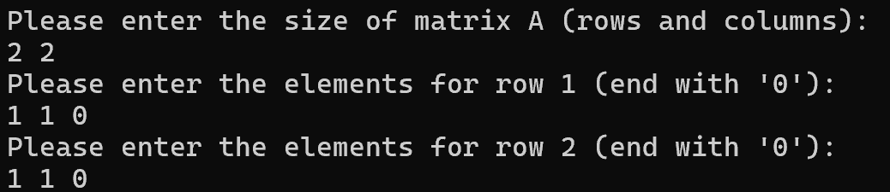

## 圖 02：矩陣輸入、串列、轉置或運算結果的原報告畫面

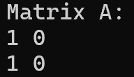

## 圖 03：矩陣輸入、串列、轉置或運算結果的原報告畫面

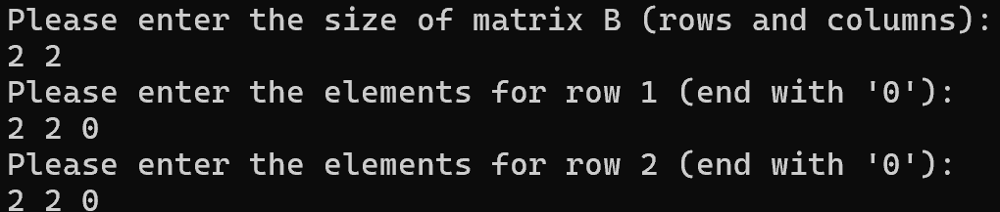

## 圖 04：矩陣輸入、串列、轉置或運算結果的原報告畫面

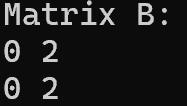

## 圖 05：矩陣輸入、串列、轉置或運算結果的原報告畫面

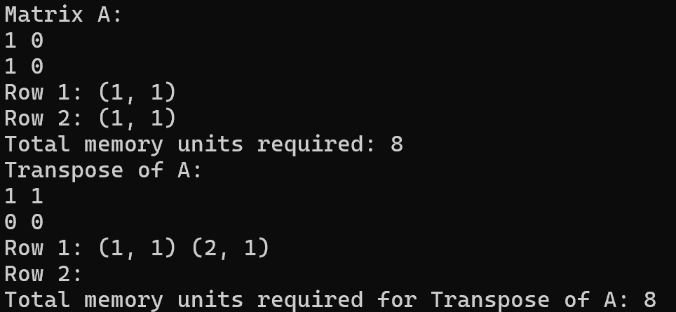

## 圖 06：矩陣輸入、串列、轉置或運算結果的原報告畫面

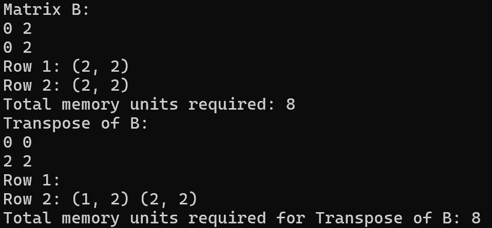

## 圖 07：矩陣加法歷史結果

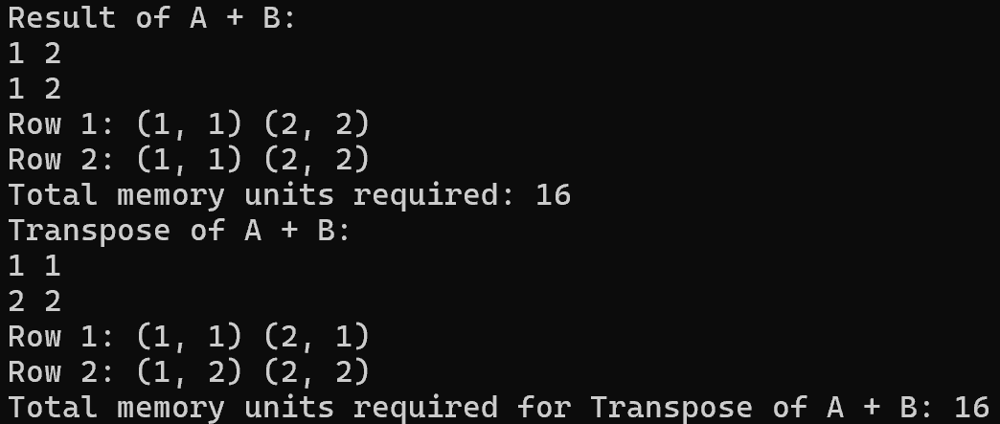

## 圖 08：矩陣乘法歷史結果

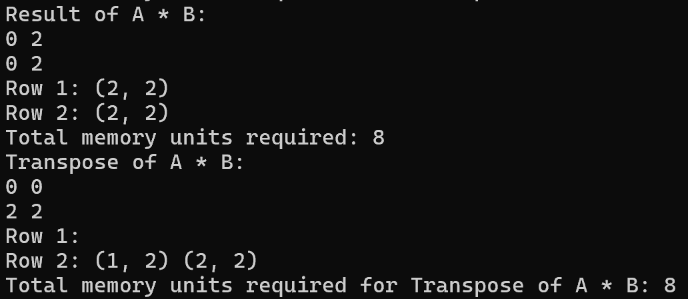

## 圖 09：矩陣輸入、串列、轉置或運算結果的原報告畫面

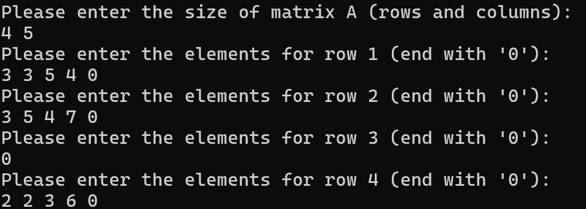

## 圖 10：矩陣輸入、串列、轉置或運算結果的原報告畫面

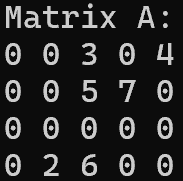

## 圖 11：矩陣輸入、串列、轉置或運算結果的原報告畫面

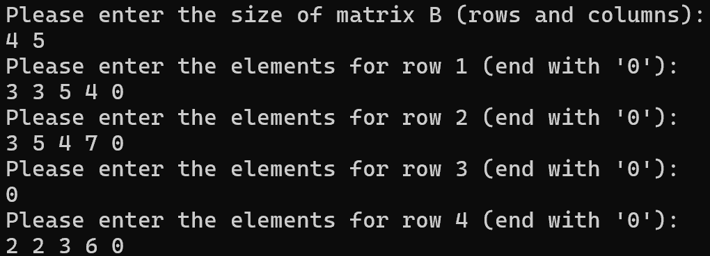

## 圖 12：矩陣輸入、串列、轉置或運算結果的原報告畫面

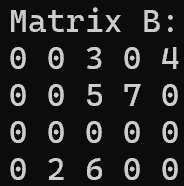

## 圖 13：矩陣輸入、串列、轉置或運算結果的原報告畫面

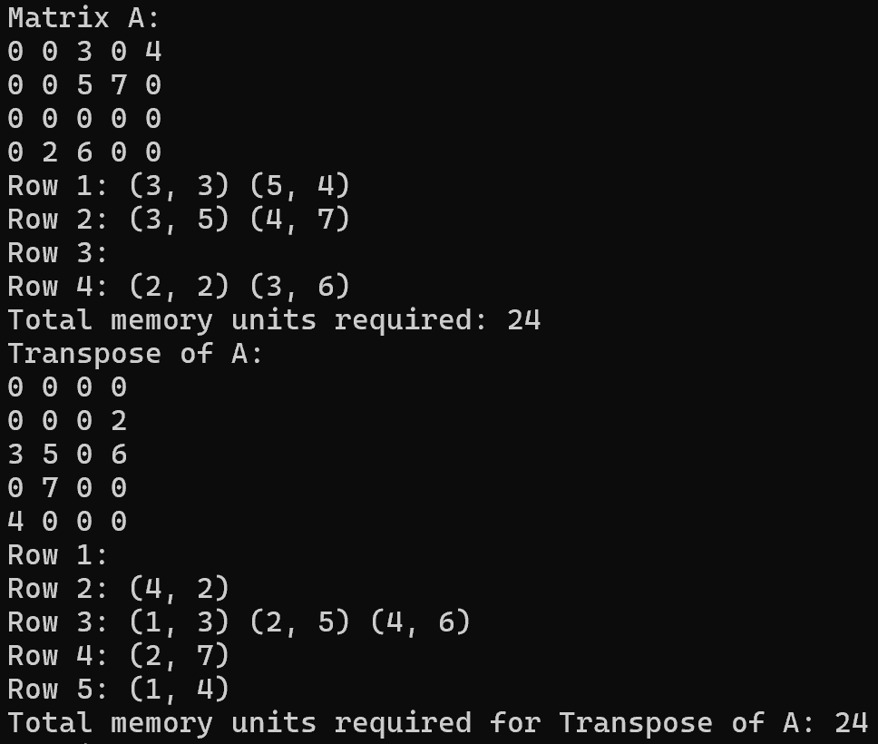

## 圖 14：矩陣輸入、串列、轉置或運算結果的原報告畫面

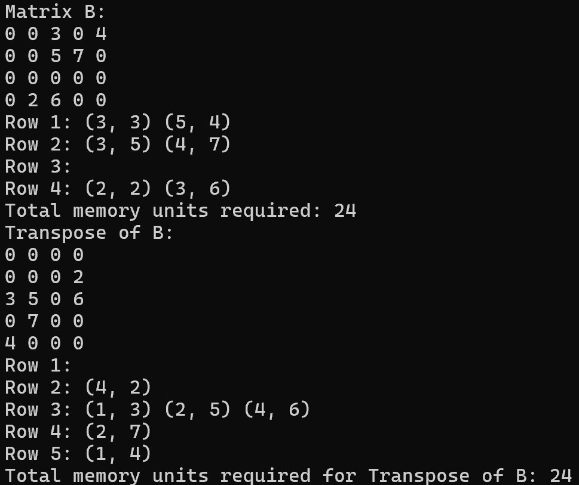

## 圖 15：4 x 5 矩陣加法歷史結果

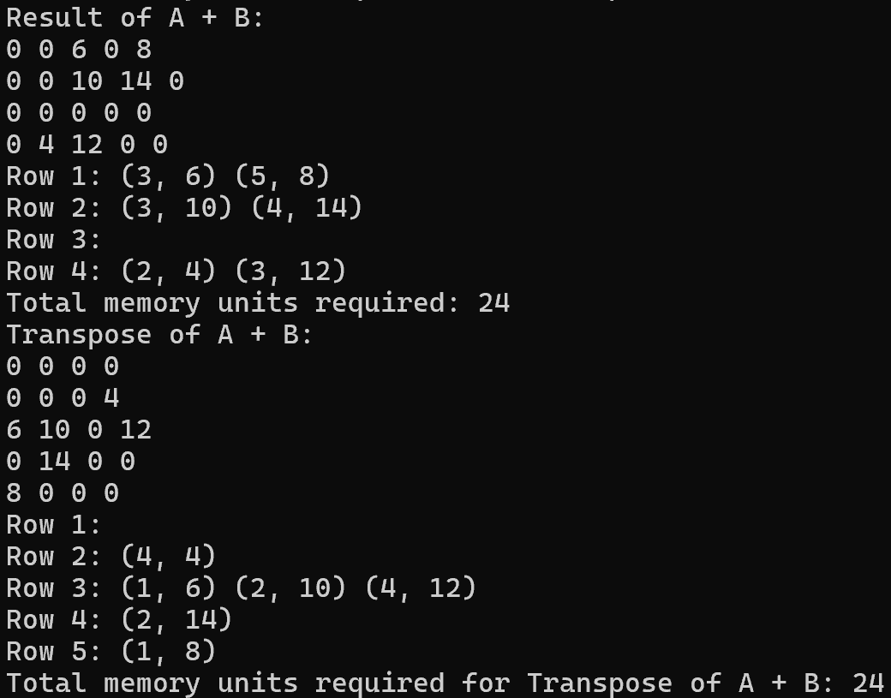

## 圖 16：維度不符的歷史提示

## 圖 17：矩陣輸入、串列、轉置或運算結果的原報告畫面

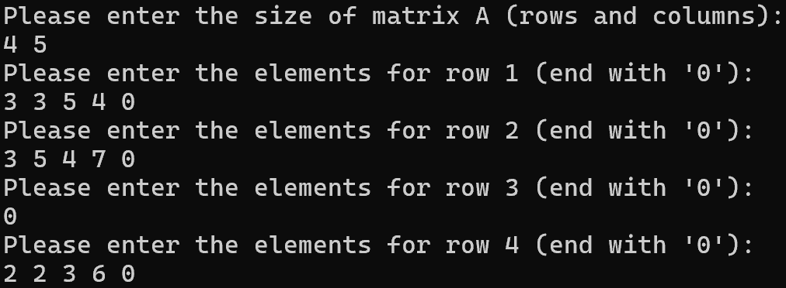

## 圖 18：矩陣輸入、串列、轉置或運算結果的原報告畫面

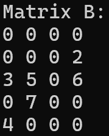

## 圖 19：矩陣輸入、串列、轉置或運算結果的原報告畫面

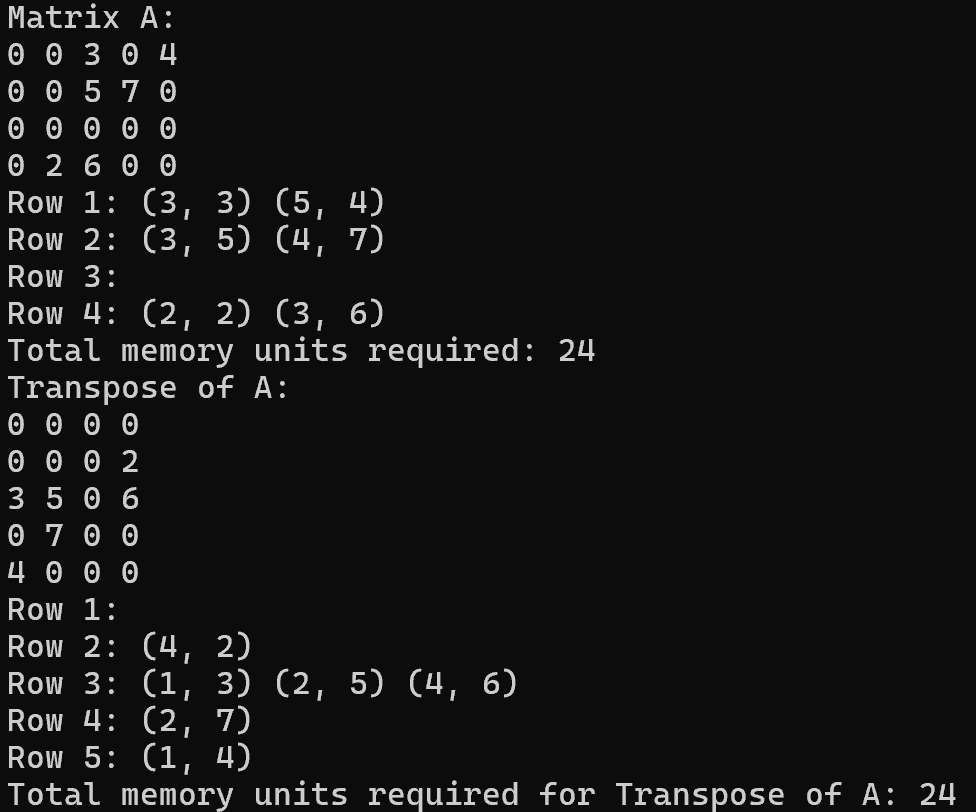

## 圖 20：矩陣輸入、串列、轉置或運算結果的原報告畫面

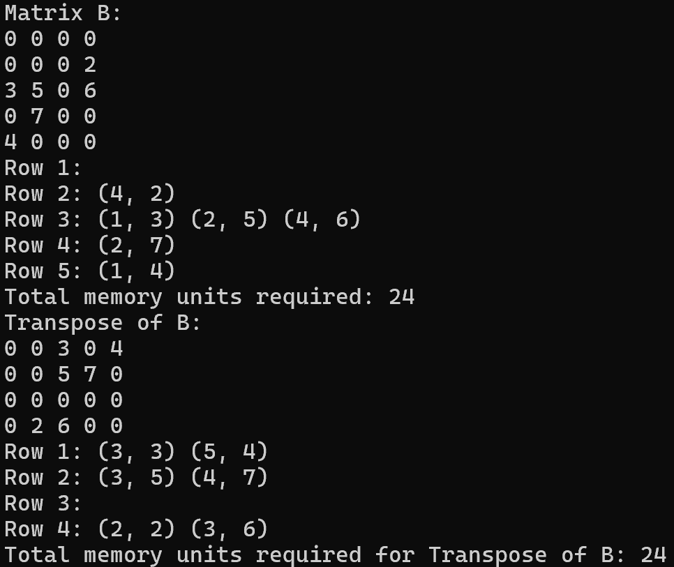

## 圖 21：矩陣輸入、串列、轉置或運算結果的原報告畫面

## 圖 22：4 x 4 矩陣乘法歷史結果

## 圖 23：矩陣輸入、串列、轉置或運算結果的原報告畫面

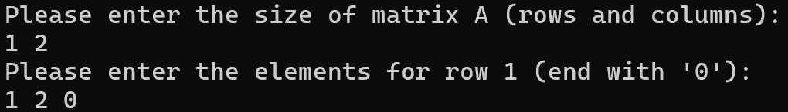

## 圖 24：矩陣輸入、串列、轉置或運算結果的原報告畫面

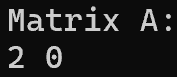

## 圖 25：矩陣輸入、串列、轉置或運算結果的原報告畫面

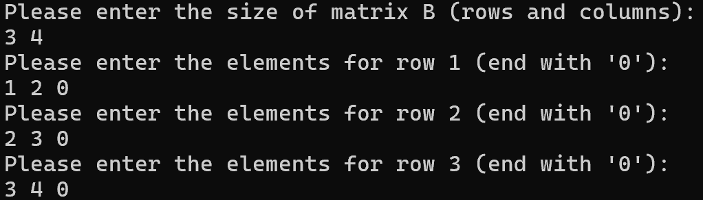

## 圖 26：矩陣輸入、串列、轉置或運算結果的原報告畫面

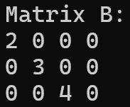

## 圖 27：矩陣輸入、串列、轉置或運算結果的原報告畫面

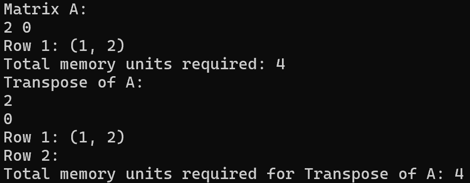

## 圖 28：矩陣輸入、串列、轉置或運算結果的原報告畫面

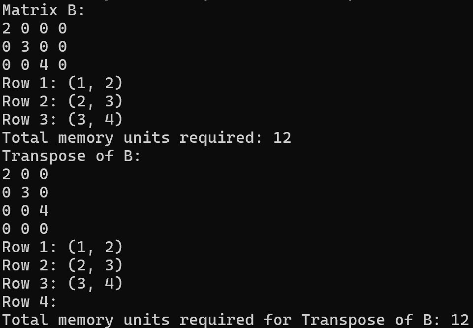

## 圖 29：維度不符的歷史案例

## 圖 30：維度不符的歷史案例

## 圖 31：矩陣輸入、串列、轉置或運算結果的原報告畫面

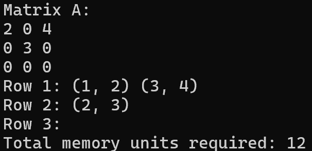

## 圖 32：矩陣輸入、串列、轉置或運算結果的原報告畫面

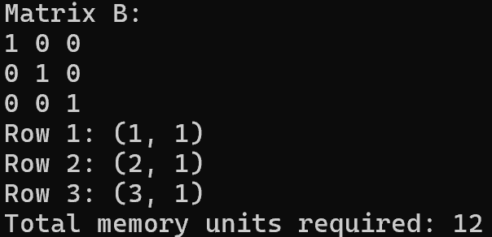

## 圖 33：單位矩陣乘法歷史結果

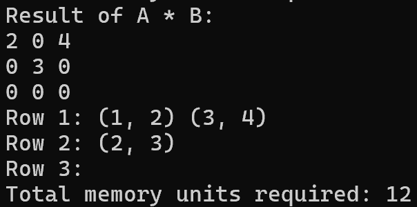
