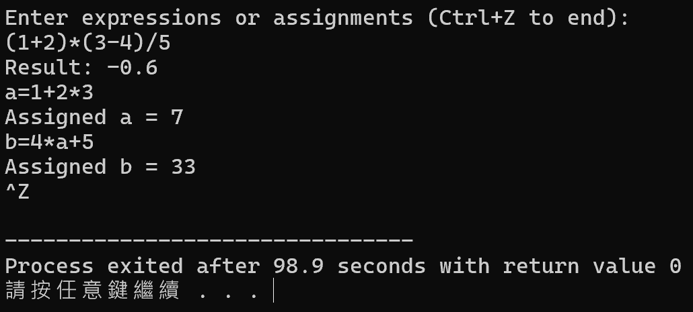

# Assignment V：雙堆疊運算式計算器

[課程首頁](../../README.md) · [全部報告圖片](RESULTS.md) · [逐檔索引](FILES.md)

## 目的與用途

以數值與運算子兩個 stack 直接求值中序運算式，支援基本四則運算、括號與小寫字母變數。學習將表面上的字串轉換成有優先順序的計算，而不是只從左至右執行。

可作為計算器、簡易 DSL、設定檔算式或編譯器 expression evaluation 的入門模型。本版不是完整程式語言解析器，不能將它當成可接受任意使用者輸入的安全計算服務。

## 程式與資料結構

主版本：[Programming_Assignment_V.c](src/Programming_Assignment_V.c)。使用 `double` 數值 stack、字元 operator stack，以及長度 26 的變數值陣列。兩個 stack 各最多 100 個元素，運算式緩衝區為 256 bytes。

| 結構 | 功能 |
| --- | --- |
| 數值 stack | 保存已解析數字、變數值與中間結果 |
| 運算子 stack | 保存等待執行的 `+ - * /` 與 `(` |
| precedence 規則 | `* /` 優先於 `+ -`，括號隔開局部計算 |
| variable table | 以 `a` 至 `z` 對應 26 個 double 值 |

數字以 `strtod` 解析，可處理一般正小數。多字元識別字、函式、指數運算及完整的一元運算規則不是本版已實作範圍。

## 求值流程

1. 數字或變數轉成值並 push。
2. 遇 `(` 時 push；遇 `)` 時執行到對應左括號。
3. 遇運算子時，先執行 stack 上優先序不低於目前運算子的操作，再將目前運算子 push。
4. 執行二元運算時先取右操作數、再取左操作數，避免減除順序顛倒。
5. 字串結束後處理剩餘運算子。
6. 若判定為變數指派，將結果寫入變數表。

正常且合法的 expression，每個 token 入／出 stack 的次數有限，時間 O(L)、空間 O(L)；實際上又受到固定 stack 與字串容量限制。

## 輸入與重新驗證

每行一條運算式，可持續輸入到 EOF。[expressions.txt](examples/expressions.txt) 包含：

```text
1 + 2 * 3
(1 + 2) * (3 - 4) / 5
a = 7
b = 4 * a + 5
b
```

本次核對得到 7、-0.6、a=7、b=33、b 的值 33。另確認除以零時會顯示 `Division by zero`，不是正常有限數值結果。

```powershell
gcc -std=gnu11 assignments/assignment05-expression/src/Programming_Assignment_V.c -o build/expression.exe -lm
Get-Content assignments/assignment05-expression/examples/expressions.txt | .\build\expression.exe
```

DEBUG／測試模式與一般輸入模式在原碼中保留；若要分析內部步驟，可閱讀報告的 stack trace，勿把輸出追蹤模式的時間與純求值時間混為一談。

## 報告結果與分析

24 張報告圖包含演算步驟、括號、優先序、變數與一般執行結果。雙 stack 的價值在於不必先建立完整語法樹，也可正確處理常見的優先序。



變數的持續存在使多行運算可互相引用，但也引入「尚未賦值」與「值確實等於 0」的差異，這是目前缺少的狀態資訊。

## 規格落差與已知限制

- **未定義變數不會報錯。** 變數陣列初始化為 0，`z + 1` 在本次驗證得到 1。這是現有行為測例，不代表符合未定義變數錯誤處理的要求。
- 大寫字母會被拒絕；只支援單一小寫字母變數。
- 部分未知 token 被跳過；不完整括號、缺少操作數與錯誤的指派語法沒有可靠的完整解析驗證。
- stack overflow 可能被忽略，underflow 可能回傳 0，造成錯誤輸入仍看似得到正常數值。
- 指派解析採簡單的起始字元／等號判斷與指標位移，不是通用語法解析器。
- 一元負號未作全面設計與驗證；不要將二元減法範例擴大解讀為任意負數寫法都支援。

下一步應加入 tokenization、變數 defined flag、明確錯誤回傳、stack 容量防護與語法檢查。原課程實作保留供學習對照，沒有為文件展示而改造成另一套解析器。
