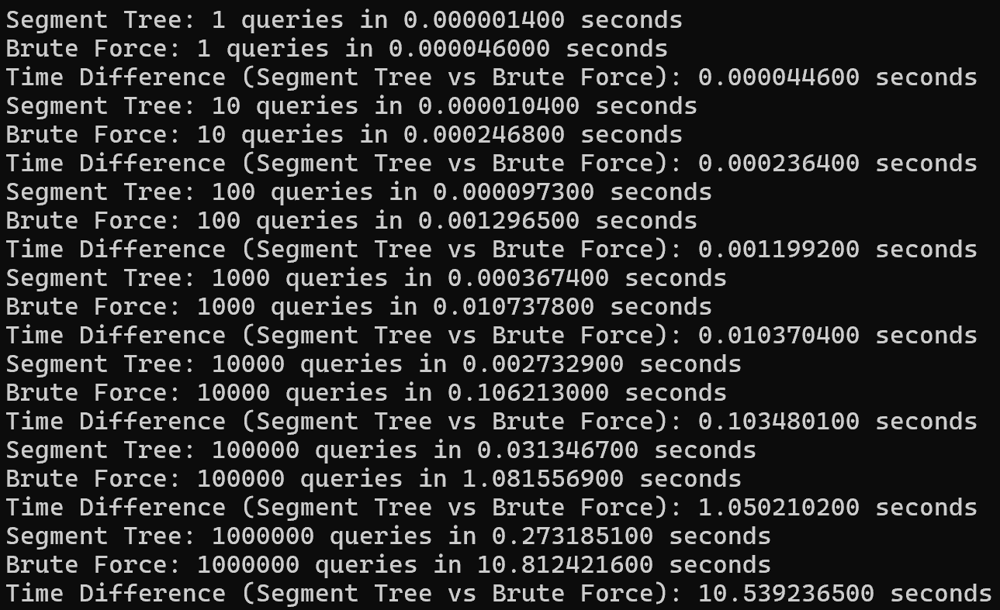

# Assignment VI：Segment Tree 區間最大值

[課程首頁](../../README.md) · [全部報告圖片](RESULTS.md) · [逐檔索引](FILES.md)

## 目的與用途

對同一個陣列執行多次 Range Maximum Query，比較預先建樹的 Segment Tree 與每次線性掃描的 Brute Force。重點在「預處理成本換取重複查詢速度」，而不只是單次查詢的時間。

可用於區間峰值、時間序列查詢、競賽問題與動態資料結構的入門。本作業主版本是最大值查詢，另附的 [extras/segment_tree.c](../../extras/segment_tree.c) 才是支援單點更新的總和範例，兩者不可混為一個已完成系統。

## 主版本與結構

主版本：[Programming_Assignment_VI.c](src/Programming_Assignment_VI.c)。每個 tree 節點保存一段陣列的最大值，以陣列模擬二元樹。

1. 根節點代表全部陣列。
2. 將區間分成左右兩半遞迴建樹。
3. 葉節點存原陣列值，內部節點取左右子節點最大值。
4. 查詢時若完全涵蓋節點區間，直接使用該節點值；否則只深入相關子樹。

配置容量為 `2 * 2^ceil(log2(n)) - 1`，足以容納補成完整二元樹的節點，空間仍為 O(n)。結構中的 `size` 欄位未初始化，但目前流程不使用該欄位。

| 方法 | 預處理 | 每次查詢 | 儲存 |
| --- | --- | --- | --- |
| Segment Tree | O(n) | O(log n) | O(n) |
| Brute Force | 不需建樹 | O(r-l+1)，最差 O(n) | 原陣列 O(n) |

若查詢很少或區間非常短，建樹與遞迴成本未必划算；查詢數量與區間長度分布都是評估重點。

## 輸入與本次結果

程式先讀 n，產生 `-50` 到 `49` 的隨機陣列，再讀查詢數 m 與每次 `l r`。查詢採 **0-based、兩端都包含**。

[queries.in](examples/queries.in)：

```text
8
4
0 7
2 5
0 0
7 7
```

本次重新執行四次查詢，tree 與 Brute Force 的結果逐次一致。隨機陣列不是固定輸入，重跑時顯示的數值可能不同；檢查重點是對同一陣列、同一查詢的兩方法結果相等。

```powershell
gcc -std=gnu11 assignments/assignment06-segment-tree/src/Programming_Assignment_VI.c -o build/segment-max.exe -lm
Get-Content assignments/assignment06-segment-tree/examples/queries.in | .\build\segment-max.exe
```

## 歷史效能結果

以下取原報告 m=1,000,000 的一組資料，單位秒，未重新量測：

| n | Segment Tree | Brute Force |
| --- | --- | --- |
| 10 | 0.067 | 0.042 |
| 100 | 0.11 | 0.087 |
| 1,000 | 0.17 | 0.41 |
| 10,000 | 0.22 | 3.5 |
| 100,000 | 0.26 | 10.9 |
| 1,000,000 | 0.27 | 10.8 |



可觀察大 n 時 tree 的成長較慢，小 n 時則可能輸給簡單掃描。但這組圖只能說明當時程式的觀察，不能當成嚴格 speedup benchmark。

## 計時解讀與限制

- DEBUG 的兩方法各自抽取隨機查詢，沒有共用同一批區間；其工作量並非完全一致。
- DEBUG 查詢結果沒有穩定地被消費／驗證，最佳化編譯可能移除部分工作；不同旗標不能直接比較。
- 報告將 0.27 秒描述為在 10^-1 秒以內並不精確；此處保留數值而不沿用該結論。
- 互動輸入未完整檢查 n、m、l、r；超出範圍可能使 Brute Force 讀取越界。
- 主版本沒有 update 功能；只是靜態陣列上的最大值查詢。

較嚴謹的效能比較應先產生固定查詢列表，兩方法共用該列表，累計結果 checksum 防止最佳化刪除，分開記錄建樹與查詢時間，並重複量測。這些是後續建議，不是原圖已經證明的測試條件。
