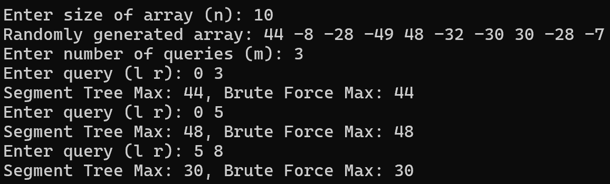
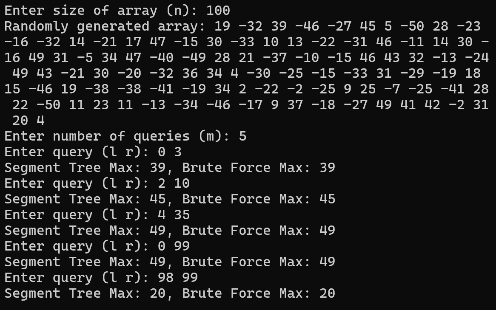
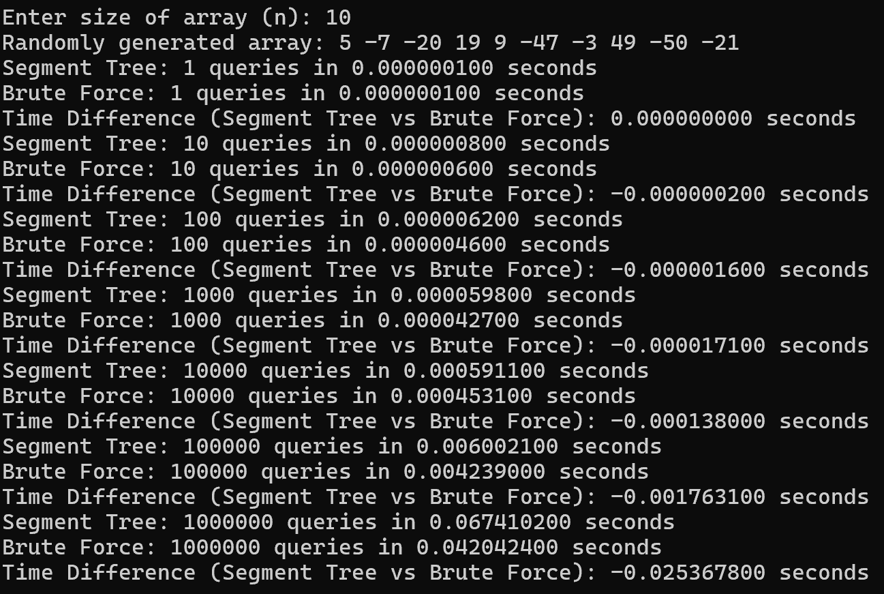
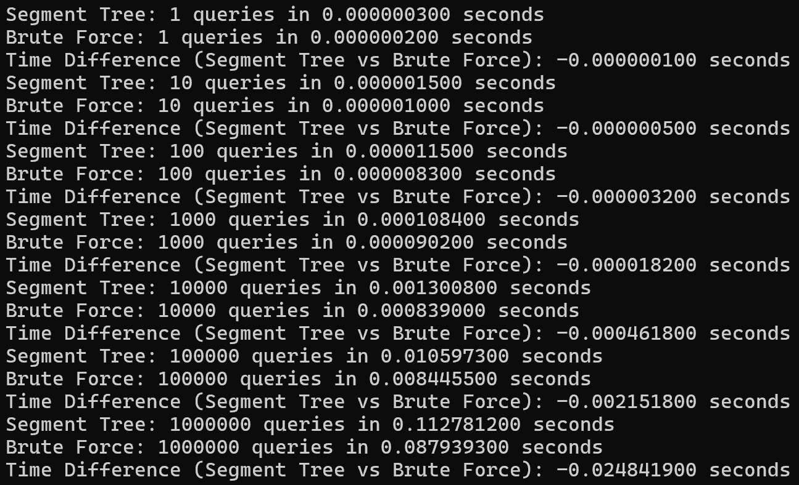
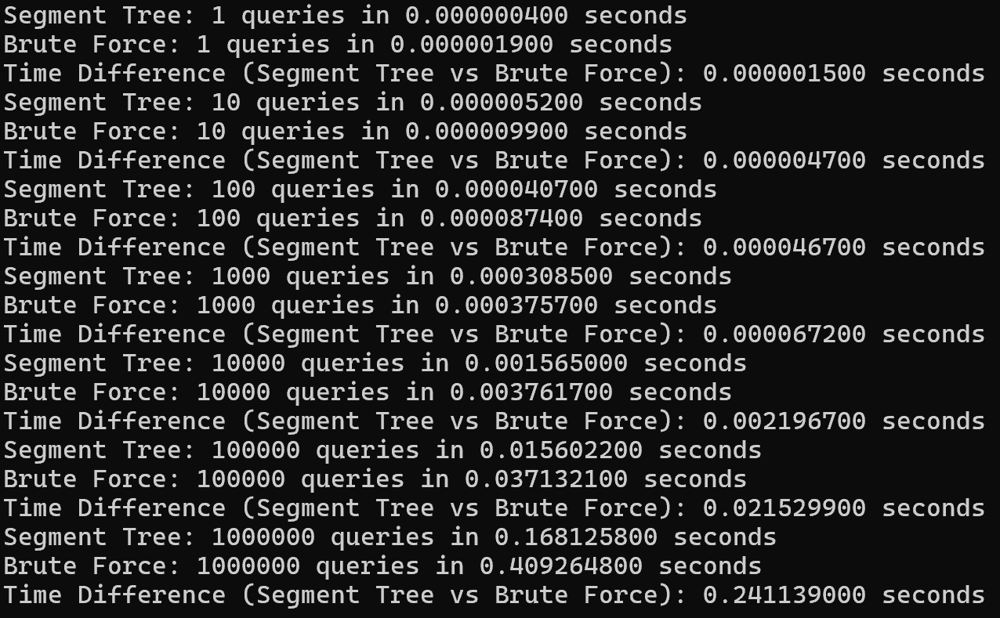
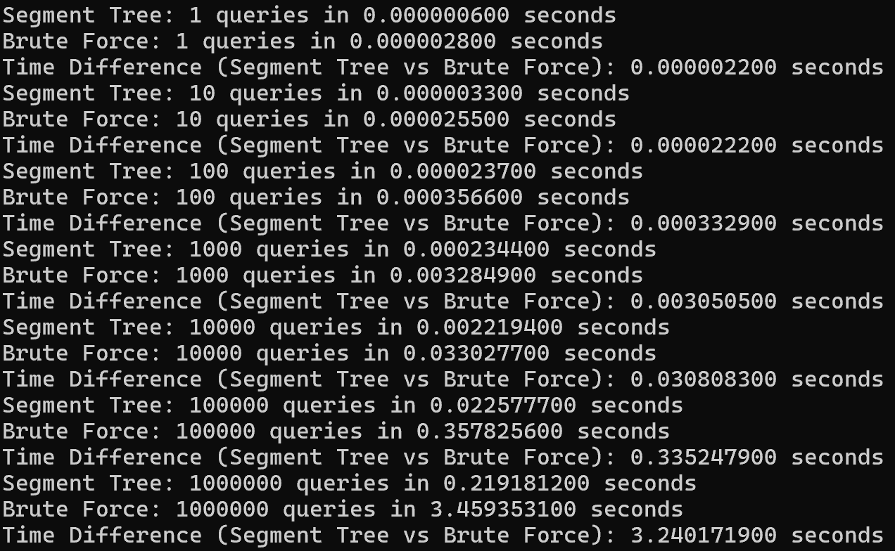
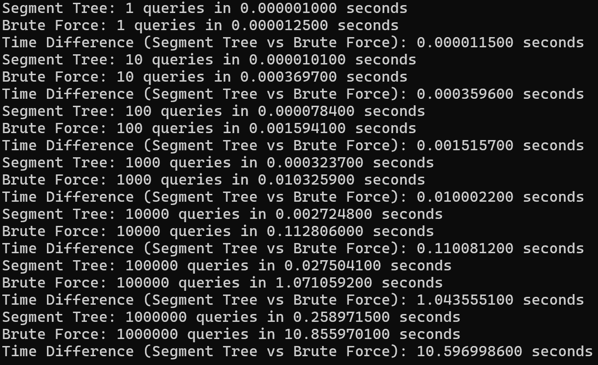

# Assignment VI：完整報告圖片

[作業說明](README.md) · [程式索引](FILES.md)

本頁收錄原 Word 報告內的 8 張圖片。依媒體檔編號排列，該順序不保證等同 Word 的閱讀順序；不是本次驗證工具的新截圖。圖中文字、時間與測試資料均屬歷史紀錄，解讀請配合作業 README。

PNG 可直接檢視；SVG 另提供向量連結，不將向量與 PNG 重複版本算成額外獨立測試。

## 圖 01：互動查詢與最大值核對

## 圖 02：互動查詢與最大值核對

## 圖 03：不同資料量／查詢量的歷史時間（比較限制見 README）

## 圖 04：不同資料量／查詢量的歷史時間（比較限制見 README）

## 圖 05：不同資料量／查詢量的歷史時間（比較限制見 README）

## 圖 06：不同資料量／查詢量的歷史時間（比較限制見 README）

## 圖 07：不同資料量／查詢量的歷史時間（比較限制見 README）

## 圖 08：不同資料量／查詢量的歷史時間（比較限制見 README）

