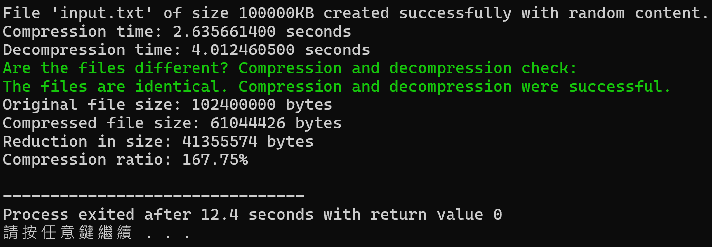

# Assignment VII：Huffman 壓縮與解壓縮

[課程首頁](../../README.md) · [全部報告圖片](RESULTS.md) · [逐檔索引](FILES.md)

## 目的與用途

依符號出現頻率建立 Huffman Tree，將常見符號轉成較短的前綴碼，練習 Min-Heap、貪婪策略、樹走訪、位元封裝與檔案 I/O。解壓縮還原後需與原檔比較，才能驗證無失真壓縮。

本實作適合展示編碼原理與壓縮流程。它不是通用檔案格式，也不能直接替代 ZIP／gzip；真正可攜的格式還需要儲存編碼表／樹、檔頭、位元長度與完整錯誤處理。

## 主要程式與版本

主版本：[7_14.c](src/7_14.c)。`archive/` 保存 `7_1.c` 至 `7_13.c` 等演進版本，逐檔資訊見 `FILES.md`。Word 報告局部作業編號與內容不一致；此處依 Huffman 原碼與題目對應為 Assignment VII，而不是沿用錯誤的頁首編號。

| 結構 | 角色 |
| --- | --- |
| frequency[256] | 統計 byte 符號頻率 |
| MinHeapNode | 符號、頻率與左右子樹 |
| Min-Heap | 每次取得頻率最小的兩棵樹 |
| codes[256][256] | 每個符號的 `'0'/'1'` 字串碼 |
| bit buffer | 將編碼串流以每 8 bit 封裝成一個 byte |

## 演算法流程

1. 讀取輸入、統計各符號頻率。
2. 將有出現的符號各自建立葉節點，放進 Min-Heap。
3. 反覆取出兩個最小頻率節點，合併為父節點再放回 Heap。
4. 由根向左／右賦予 0／1，得到 prefix-free code。
5. 再讀一次輸入，將每個符號換成碼並逐 bit 寫入檔案。
6. 尾端不足 8 bit 補 0，再附上有效 bit 數。
7. 解碼時沿原本的 Huffman Tree 走到葉節點，輸出符號。
8. 比較原檔與還原檔。

DEBUG 使用 `abcabdcc`，頻率為 a:2、b:2、c:3、d:1。原報告的一組編碼為 a=`10`、b=`111`、c=`0`、d=`110`；頻率相同的節點可能有不同 tie-breaking，其他等效 prefix code 也可能正確，不必把這一組碼視為唯一答案。

## 複雜度

令 N 為輸入 byte 數，K 為符號種類數，B 為編碼 bit 數。統計 O(N)，建樹 O(K log K)，編碼／解碼需處理對應的 bit，約 O(N+B)；樹與頻率表空間 O(K)，碼表另取決於各碼長。檔案採串流讀寫，不需要把完整大型輸入載入記憶體。

目前 K 最多 256，因此教學測例主要成本在檔案掃描與 bit 操作。但 `int` 記錄總 bit 數仍限制了可處理的極大輸入。

## 執行方式與覆寫注意

一般模式的 `main` 呼叫 `generateFile(1)`，實際產生 **1 KB** 隨機英文字母輸入；原碼旁的「100 KB」註解與呼叫值不符。此模式會覆寫工作目錄的 `input.txt`，並寫入 `compressed.bin`、`output.txt`，不能直接拿既有歷史資料當工作目錄。

在 repository 根目錄編譯，然後切到獨立工作目錄：

```powershell
gcc -std=gnu11 -D_POSIX_C_SOURCE=200809L assignments/assignment07-huffman/src/7_14.c -o build/huffman.exe -lm
New-Item -ItemType Directory -Force build/huffman-run | Out-Null
Push-Location build/huffman-run
..\huffman.exe
Pop-Location
```

若只看樹與編碼，編譯時加 `-DDEBUG`。原保存的 [input.txt](examples/input.txt) 與 [output.txt](examples/output.txt) 為歷史文字樣本，不是本次隨機產生的 1 KB 檔案。

## 結果與壓縮比正確解讀

本次新測例輸入 1024 bytes，壓縮為 608 bytes，輸出與輸入**獨立逐 byte 比較完全一致**。這是當次小型 round-trip 結果，隨機內容不同時壓縮大小會略變。

程式印的比率定義為：

```text
ratio (%) = original bytes / compressed bytes * 100
reduction (%) = (1 - compressed bytes / original bytes) * 100
```

所以畫面顯示約 168% 代表原檔約為壓縮檔的 1.68 倍，**不是「檔案變成 168% 大」或「減少 168%」**。本次實際減少 416 bytes，約 40.6%。

歷史報告表，時間單位秒、size 依原程式的 KB=1024 bytes：

| 輸入 KB | original/compressed 比值 | 壓縮秒數 | 解壓縮秒數 |
| --- | --- | --- | --- |
| 1 | 1.6870 | 0.0000819 | 0.0001067 |
| 10 | 1.6820 | 0.0003399 | 0.0008323 |
| 100 | 1.6795 | 0.0030782 | 0.0040686 |
| 1,000 | 1.6779 | 0.0272365 | 0.0453894 |
| 10,000 | 1.6776 | 0.2978027 | 0.4122312 |
| 100,000 | 1.6775 | 2.6356614 | 4.0124605 |



隨機 26 字母的頻率接近均勻，需要約 4.7 bit/字母，對原 8-bit 儲存可期待接近上述壓縮率。這是對測試資料分布的解釋，不能推論影像、已壓縮檔或任意二進位資料都能減少四成。

## 限制與分析

- 壓縮檔沒有序列化 Huffman Tree；解壓縮直接使用同一次程序中的樹，**不能只拿 compressed.bin 在另一程序獨立還原**。
- 尾端 bit 數用原生 `int` 寫入，在本次工具鏈為 4 bytes；大小與 endian 不是可攜格式規範。
- 空檔與單一種類符號未完整處理；單一葉節點可能得到空碼。
- 來源檔以文字模式開啟，且部分樹碼索引用 signed char；目前英文字母樣本的成功不能證明任意二進位 byte 都安全。
- 內建 `verifyFiles` 的 EOF 處理不足以取代嚴格的完整 byte 比較；本次工具另外讀取兩檔並檢查完全相等。
- 計時主要包住壓縮與解壓縮呼叫，頻率統計／建樹與檔案產生不全包含在該數字裡。

要做真正的檔案工具，應先定義完整格式與壞檔處理，再加入空檔、單符號、所有 256 byte、截斷資料與大檔測試。
