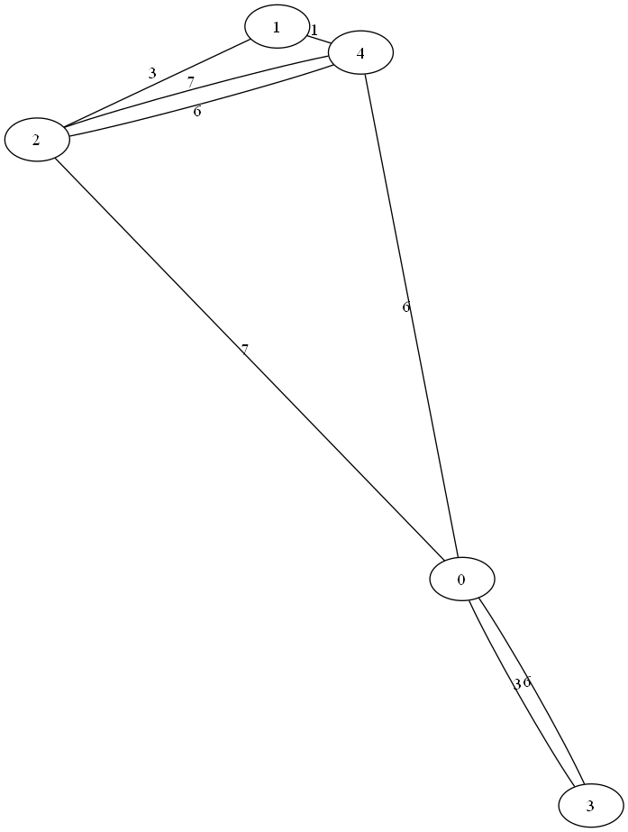
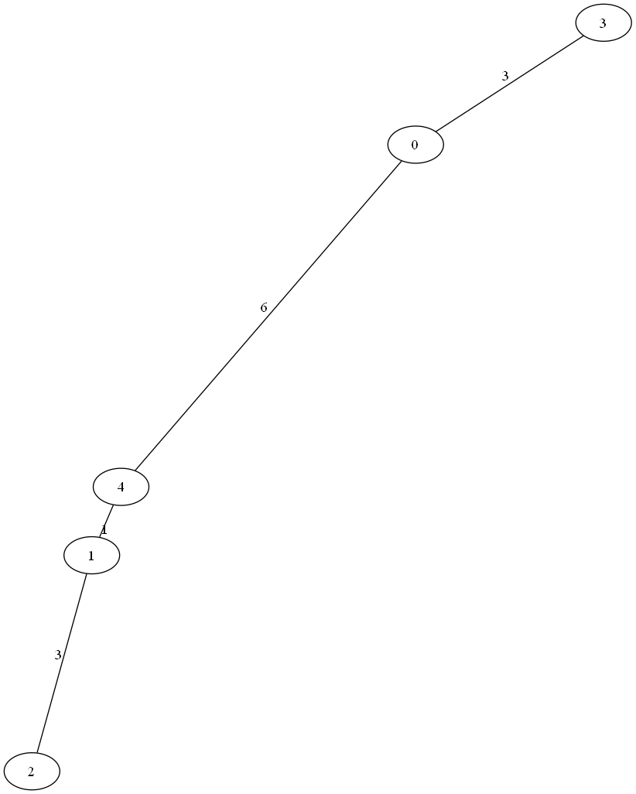

# Assignment VIII：Kruskal 最小生成樹

[課程首頁](../../README.md) · [全部報告圖片](RESULTS.md) · [逐檔索引](FILES.md)

## 目的與應用

從無向加權圖選出連接所有頂點且總權重最小的一組邊，學習貪婪策略、邊排序與 Union-Find。常見概念用途包含最低成本網路連線、管線／佈線規劃與群聚；真實工程仍可能有冗餘、容量或幾何限制，不能只靠 MST 解決所有設計需求。

MST 最小化的是**整棵樹的總邊權重**，不是從某個 source 到每一點的距離。後續 Dijkstra 處理的是另一個目標。

## 程式與檔案

| 程式 | 功能 |
| --- | --- |
| [8_5.c](src/8_5.c) | 讀圖、Kruskal、結果列印與 DOT 輸出 |
| [8_txt.c](src/8_txt.c) | 互動輸入 V、E，產生 `graph.txt` |

主版本的圖檔使用 **edge list**，不是逐列輸入的稀疏矩陣：

```text
V E
src dest weight
...
```

頂點是 0-based。`Edge` 陣列存端點與權重，`Subset` 存 parent、rank。Union-Find 同時使用 path compression 與 union by rank。

## Kruskal 流程與分析

1. 讀取所有 E 條邊，以 `qsort` 依權重排序。
2. 初始化 V 個各自獨立的集合。
3. 從最小權重邊開始，找兩端點的代表元。
4. 若屬不同集合，選入該邊並合併；否則略過，避免形成環。
5. 選滿 V-1 邊或邊全部處理完後，列印結果、總權重及 DOT。

排序為 O(E log E)，Union-Find 操作整體約 O(E α(V))，儲存 O(V+E)。原報告將成長稱為指數級並不符合此程式的演算法結構；耗時增加也不能單憑幾筆量測推導指數複雜度。

## 小型可重現範例

[small-graph.txt](examples/small-graph.txt) 與 Assignment IX 共用相同輸入，方便比較兩類圖論問題：

```text
5 6
0 1 2
0 2 5
1 2 1
1 3 3
2 4 2
3 4 1
```

本次得到 MST 邊 `{1-2, 3-4, 0-1, 2-4}`，總權重 `1+1+2+2=6`。相同權重的列印順序可能依排序而不同，重點是無環、連通及總權重。

```powershell
gcc -std=gnu11 -D_POSIX_C_SOURCE=200809L assignments/assignment08-mst/src/8_5.c -o build/mst.exe -lm
New-Item -ItemType Directory -Force build/mst-run | Out-Null
Copy-Item assignments/assignment08-mst/examples/small-graph.txt build/mst-run/graph.txt
Push-Location build/mst-run
..\mst.exe
Pop-Location
```

若已安裝 Graphviz，可在工作目錄使用 `dot -Tpng graph.dot -o graph.png` 與 `dot -Tpng mst.dot -o mst.png`。Graphviz 負責排版，產生 DOT 的 C 程式不等於自行實作圖形繪製引擎。

## 歷史結果與解讀

報告的 5 頂點範例使用另一組邊權重，總權重 77；不是上面的新測例。原圖與結果圖、圖檔均保留於 `examples/` 和圖片索引。





以上為保留的歷史圖形，不宣稱對應新測例的總權重 6。大型測試的歷史時間：

| V | E | 秒 |
| --- | --- | --- |
| 100 | 500 | 0.0050056 |
| 200 | 1,000 | 0.0093164 |
| 500 | 2,500 | 0.0193020 |
| 1,000 | 5,000 | 0.0317146 |
| 5,000 | 25,000 | 0.1435485 |
| 10,000 | 50,000 | 0.2848600 |
| 100,000 | 500,000 | 0.9427888 |

原表部分欄位標作 ms，但原程式輸出為 seconds；此處依程式更正為秒。V=500 的 E 依截圖更正為 2,500，而非原文字表的 25,000。計時包含排序、運算、console 輸出及 DOT 寫檔，不能視為純 Union-Find／Kruskal 核心時間。

## 限制與可改善方向

- 圖不連通時選出的只是 minimum spanning forest，程式仍以 MST 顯示，沒有確認是否恰好取得 V-1 條邊。
- 產生器只排除 self-loop，**不排除重複邊，也不保證連通**；即使檢查 E 上限，也沒有使輸出成為 unique simple graph。
- 檔案的端點範圍、權重與完整讀取缺少全面驗證。
- 排序 comparator 使用整數相減，極大權重可能溢位；一般範例的 1..50 權重不會暴露此問題。

若要可靠 benchmark，應先驗證圖連通與邊分布，使用固定資料，將圖生成、輸出及 Graphviz 渲染時間分開，並核對 MST 邊數及總權重。
