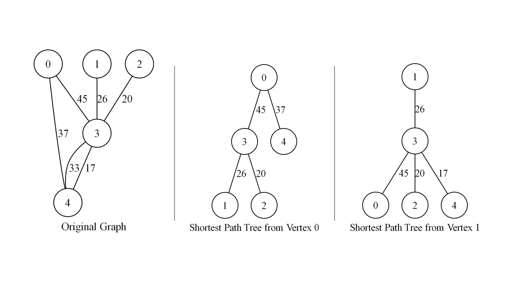

# Assignment IX：Dijkstra 加權圖最短路徑

[課程首頁](../../README.md) · [全部報告圖片](RESULTS.md) · [逐檔索引](FILES.md)

## 目的與應用

對非負權重圖計算 source 到每個頂點的最短距離，使用 parent 記錄路徑並輸出 shortest-path tree。可用於簡化導航、網路延遲分析與成本路徑問題；圖模型與權重意義必須先定義清楚。

本程式對每個頂點輪流當 source，因此一次執行會產生多棵最短路徑樹。它與 Kruskal 的最小生成樹不同；原報告少數段落沿用 Kruskal／MST 文字，此處依實際 `dijkstra` 原碼修正。

## 程式與表示法

| 程式 | 功能 |
| --- | --- |
| [9_4.c](src/9_4.c) | adjacency list、Dijkstra、路徑列印及 DOT |
| [9_txt.c](src/9_txt.c) | 產生 `graph.txt` 的互動工具 |

輸入格式與作業 VIII 相同，首行 V、E，後續為 0-based `src dest weight`。每條輸入邊插入兩個 adjacency-list node，所以目前是**無向圖**。讀取的文字是 edge list，儲存的資料結構則是 adjacency list，兩者應分開描述。

`dist[]` 保存當前距離，`visited[]` 保存已確定的頂點，`parent[]` 用於路徑回溯。無法到達的距離使用 `INT_MAX`。

## Dijkstra 流程

1. 所有距離初始化為無限大，source 設為 0。
2. 線性掃描所有未 visited 的頂點，選目前距離最小者。
3. 將該點標為 visited，遍歷它的 adjacency list。
4. 若經該點到鄰居的距離更短，更新 `dist` 與 `parent`。
5. 重複直到完成本 source 的處理。
6. 列印各點距離與完整路徑，再輸出該 source 的 DOT 樹。
7. `main` 對所有 V 個 source 重複以上流程。

目前找最小距離是**線性搜尋，不是 Min-Heap／Priority Queue**。單一 source 時間 O(V²+E)、圖空間 O(V+E)、工作陣列 O(V)。全部 source 的計算約 O(V³+VE)，還要加上路徑列印與 DOT I/O；不可套用 Heap 版本 O((V+E) log V) 的複雜度。

## 範例與重新驗證

[small-graph.txt](examples/small-graph.txt) 是與作業 VIII 相同的 5 頂點、6 邊固定圖。本次 source 0 核對結果：

| 目標 | 路徑 | 距離 |
| --- | --- | --- |
| 0 | 0 | 0 |
| 1 | 0 → 1 | 2 |
| 2 | 0 → 1 → 2 | 3 |
| 3 | 0 → 1 → 3 | 5 |
| 4 | 0 → 1 → 2 → 4 | 5 |

同一圖的 MST 總權重為 6，但沿那棵 MST 從 0 走到 3 的成本是 6；Dijkstra 找到的最低成本為 5。這正好展示「整體連線最省」和「source 到目標最短」不是同一個最佳化問題。

```powershell
gcc -std=gnu11 -D_POSIX_C_SOURCE=200809L assignments/assignment09-shortest-path/src/9_4.c -o build/shortest.exe -lm
New-Item -ItemType Directory -Force build/shortest-run | Out-Null
Copy-Item assignments/assignment09-shortest-path/examples/small-graph.txt build/shortest-run/graph.txt
Push-Location build/shortest-run
..\shortest.exe
Pop-Location
```

程式結尾有 Windows `system("pause")`，互動執行需按鍵；自動驗證會提供輸入以通過該步驟。這是平台相依的暫停行為，不是演算法必需部分。

輸出包含 `original_graph.dot` 與 `shortest_path_tree_0.dot` 等檔案。Graphviz 轉圖範例：`dot -Tpng shortest_path_tree_0.dot -o shortest_path_tree_0.png`。DOT 的樹邊權重以子／父的距離差取得，表示原邊成本，不是該點的整段累計距離。

## 歷史圖形與效能

原始圖形樣本分成 [5x6](examples/5x6/README.md)、[6x12](examples/6x12/README.md)、[20x40](examples/20x40/README.md)，保存當時的 DOT、PNG 與 source-specific 樹。報告另外有 31 張 PNG／SVG 圖片，完整索引會標示向量圖與可顯示的 PNG 對照。



歷史大型測試，原程式整輪時間單位秒：

| V | E | 所有 source、含輸出之秒數 |
| --- | --- | --- |
| 100 | 500 | 1.8956907 |
| 200 | 1,000 | 7.7295282 |
| 500 | 2,500 | 52.0503408 |
| 1,000 | 5,000 | 217.147188 |

這些值並不是一次單一 source Dijkstra 的耗時。對所有 source 重複線性選點、印出完整路徑及建立大量 DOT，會顯著增加成本；也不能與作業 VIII 一次 MST 的整輪時間直接作同工作量比較。

## 限制與改善方向

- Dijkstra 的前提是非負權重，但程式沒有完整拒絕負值；負權重輸入不能套用目前正確性結論。
- 整數累加距離可能溢位，尤其極大權重或長路徑。
- 產生器與作業 VIII 類似，可能重複邊且不保證圖連通。
- 沒有實作 Heap 版本；不將題目中的效率期待當成現有功能。
- 本次明確驗算 source 0 的五個距離；其他 source 有執行，但不宣稱全部大圖已經獨立驗算。

若要做導航服務，可先只計算使用者指定 source，加入輸入防護與較寬距離型別，再改為 Min-Heap 的 Dijkstra。若需要負權重，應另選適合的演算法，而不是只放寬輸入檢查。
