# Assignment IX：完整報告圖片

[作業說明](README.md) · [程式索引](FILES.md)

本頁收錄原 Word 報告內的 31 張圖片。依媒體檔編號排列，該順序不保證等同 Word 的閱讀順序；不是本次驗證工具的新截圖。圖中文字、時間與測試資料均屬歷史紀錄，解讀請配合作業 README。

PNG 可直接檢視；SVG 另提供向量連結，不將向量與 PNG 重複版本算成額外獨立測試。

## 圖 01：加權圖、各 source 路徑或 shortest-path tree 的歷史結果

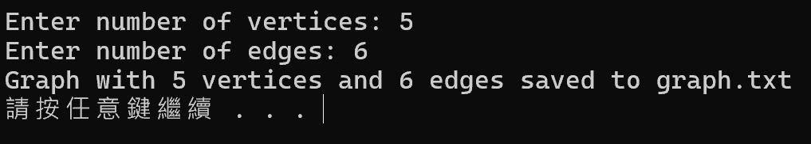

## 圖 02：加權圖、各 source 路徑或 shortest-path tree 的歷史結果

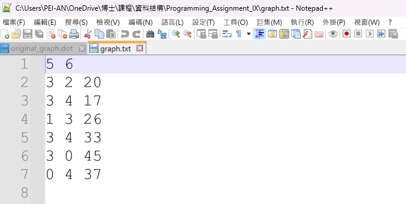

## 圖 03：加權圖、各 source 路徑或 shortest-path tree 的歷史結果

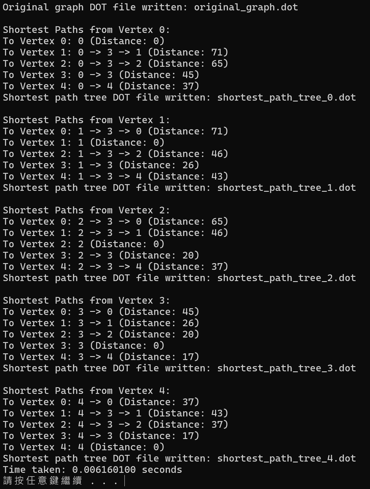

## 圖 04：加權圖、各 source 路徑或 shortest-path tree 的歷史結果

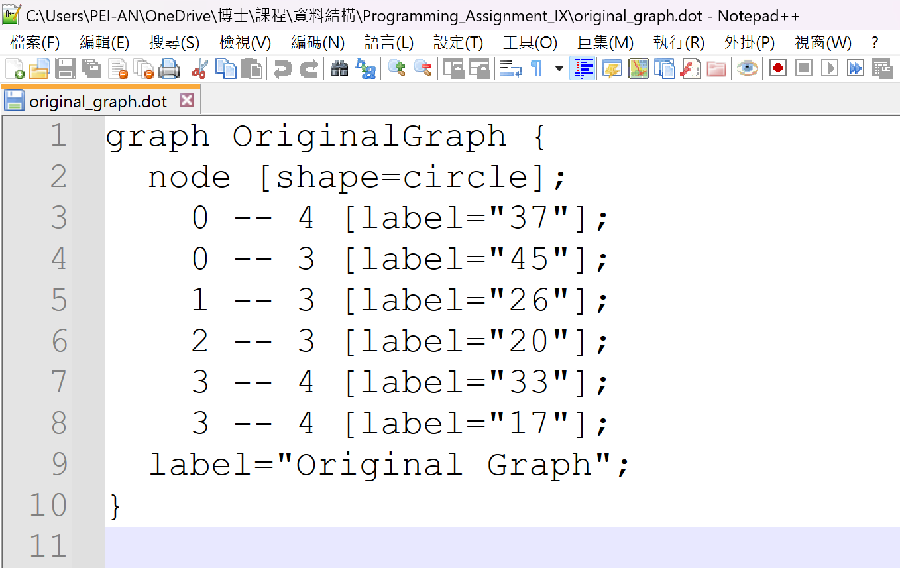

## 圖 05：加權圖、各 source 路徑或 shortest-path tree 的歷史結果

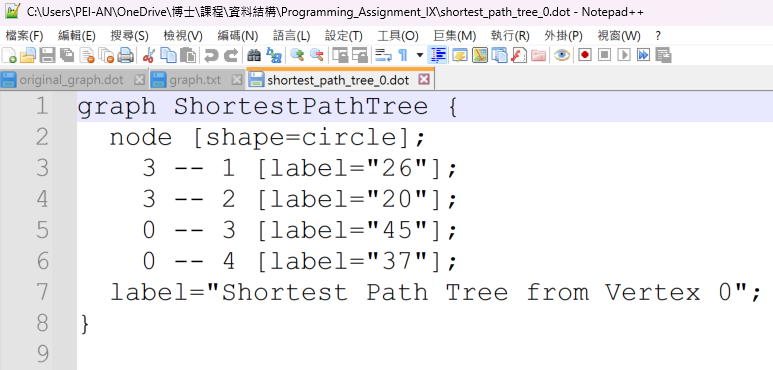

## 圖 06：加權圖、各 source 路徑或 shortest-path tree 的歷史結果

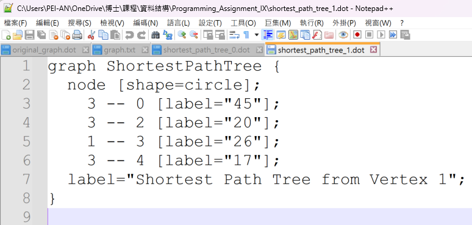

## 圖 07：加權圖、各 source 路徑或 shortest-path tree 的歷史結果

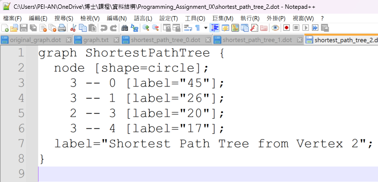

## 圖 08：加權圖、各 source 路徑或 shortest-path tree 的歷史結果

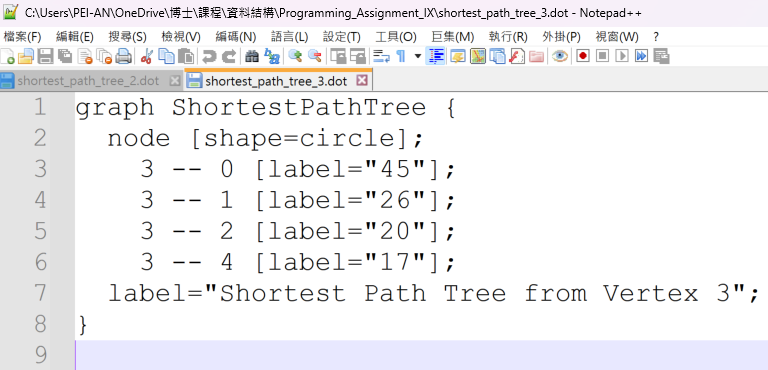

## 圖 09：加權圖、各 source 路徑或 shortest-path tree 的歷史結果

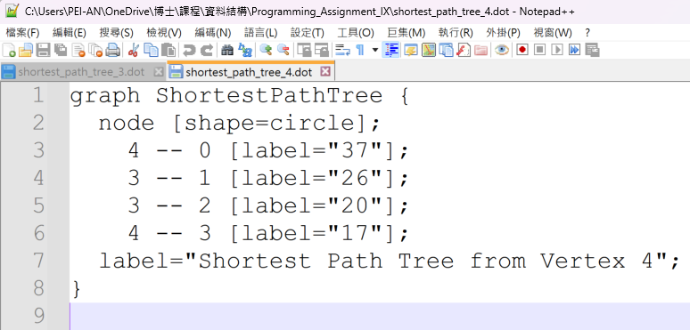

## 圖 10：加權圖、各 source 路徑或 shortest-path tree 的歷史結果

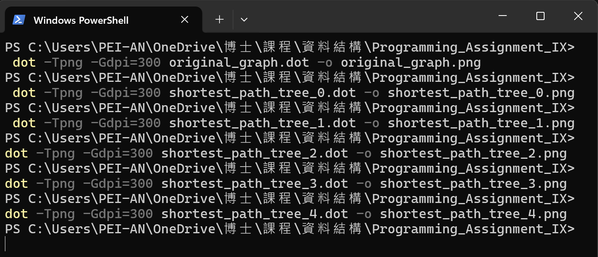

## 圖 11：加權圖、各 source 路徑或 shortest-path tree 的歷史結果

## 圖 12：歷史圖形的向量版本（鄰近 PNG 為顯示用版本）

[向量圖檔](assets/report-12.svg)

## 圖 13：加權圖、各 source 路徑或 shortest-path tree 的歷史結果

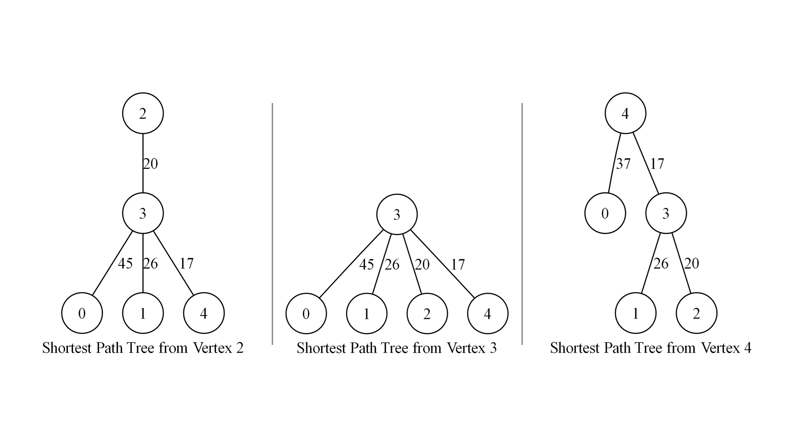

## 圖 14：歷史圖形的向量版本（鄰近 PNG 為顯示用版本）

[向量圖檔](assets/report-14.svg)

## 圖 15：加權圖、各 source 路徑或 shortest-path tree 的歷史結果

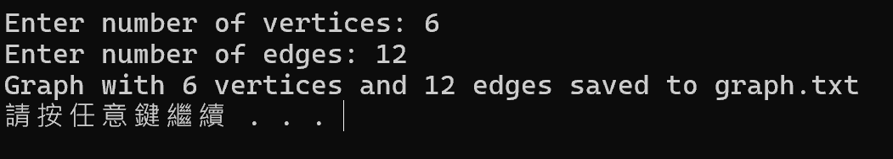

## 圖 16：加權圖、各 source 路徑或 shortest-path tree 的歷史結果

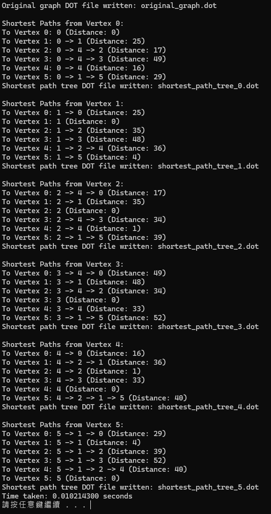

## 圖 17：加權圖、各 source 路徑或 shortest-path tree 的歷史結果

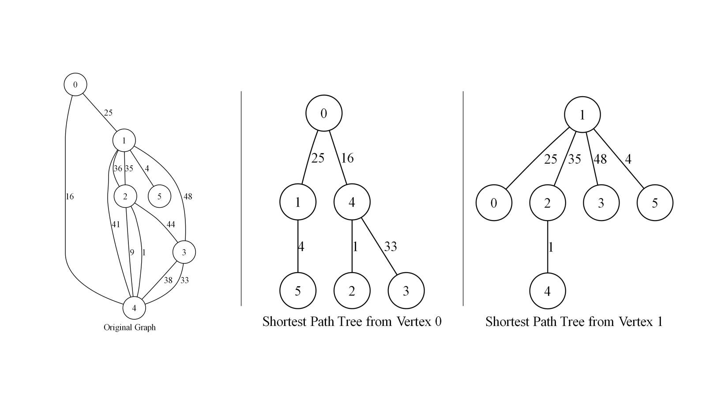

## 圖 18：加權圖、各 source 路徑或 shortest-path tree 的歷史結果

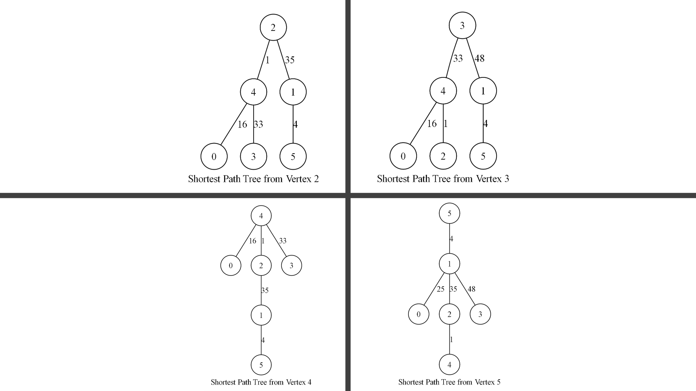

## 圖 19：歷史圖形的向量版本（鄰近 PNG 為顯示用版本）

[向量圖檔](assets/report-19.svg)

## 圖 20：加權圖、各 source 路徑或 shortest-path tree 的歷史結果

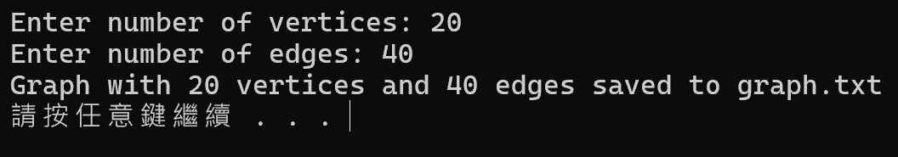

## 圖 21：加權圖、各 source 路徑或 shortest-path tree 的歷史結果

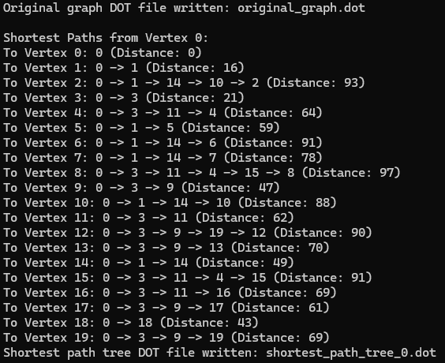

## 圖 22：加權圖、各 source 路徑或 shortest-path tree 的歷史結果

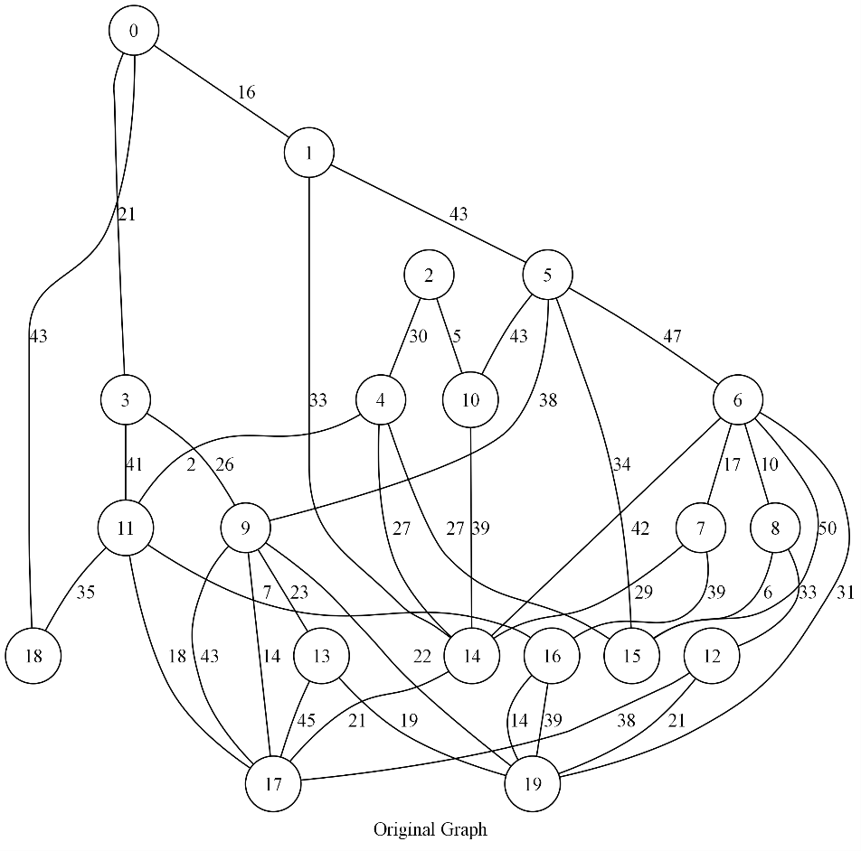

## 圖 23：加權圖、各 source 路徑或 shortest-path tree 的歷史結果

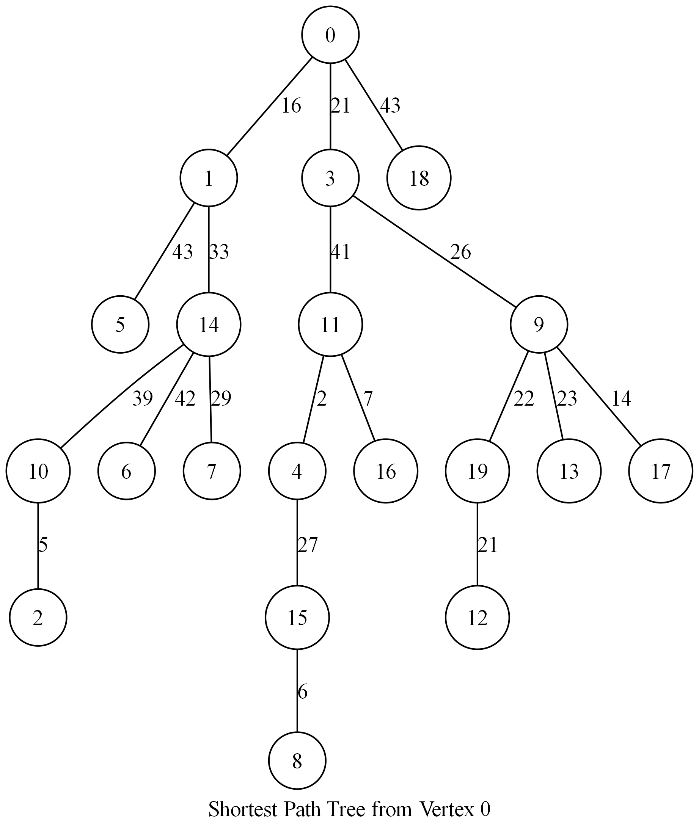

## 圖 24：加權圖、各 source 路徑或 shortest-path tree 的歷史結果

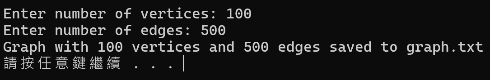

## 圖 25：大型圖的所有 source 執行與計時歷史結果

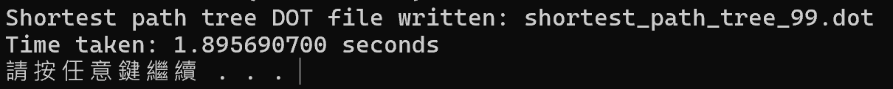

## 圖 26：大型圖的所有 source 執行與計時歷史結果

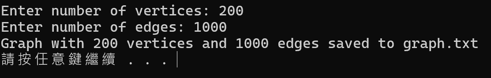

## 圖 27：大型圖的所有 source 執行與計時歷史結果

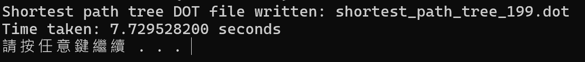

## 圖 28：大型圖的所有 source 執行與計時歷史結果

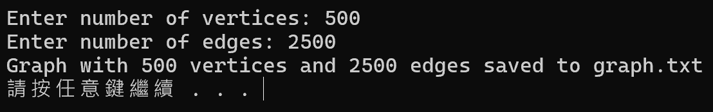

## 圖 29：大型圖的所有 source 執行與計時歷史結果

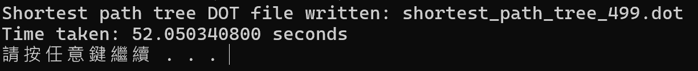

## 圖 30：大型圖的所有 source 執行與計時歷史結果

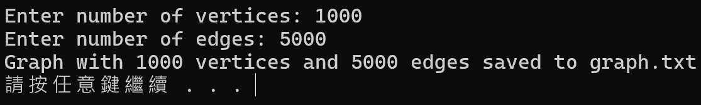

## 圖 31：大型圖的所有 source 執行與計時歷史結果

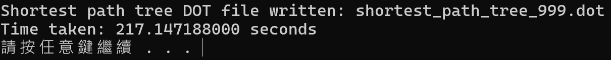
