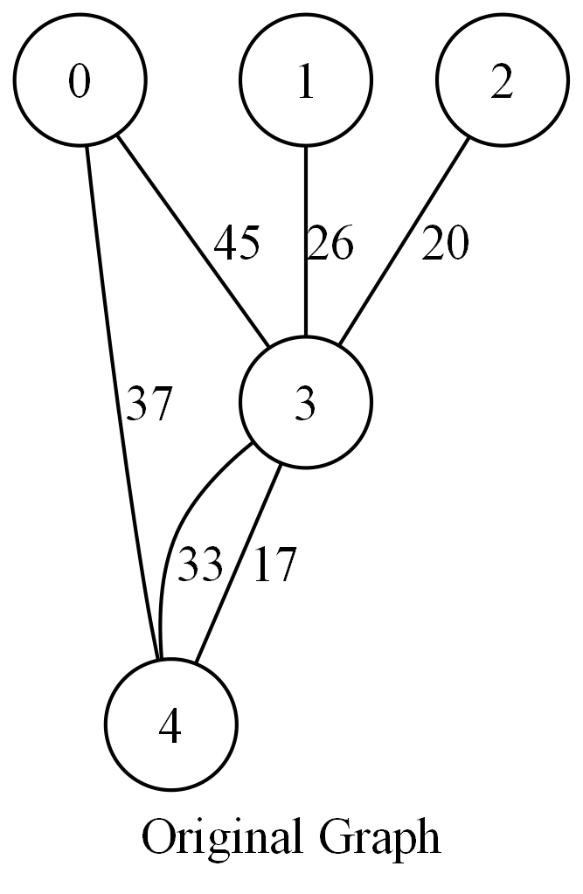
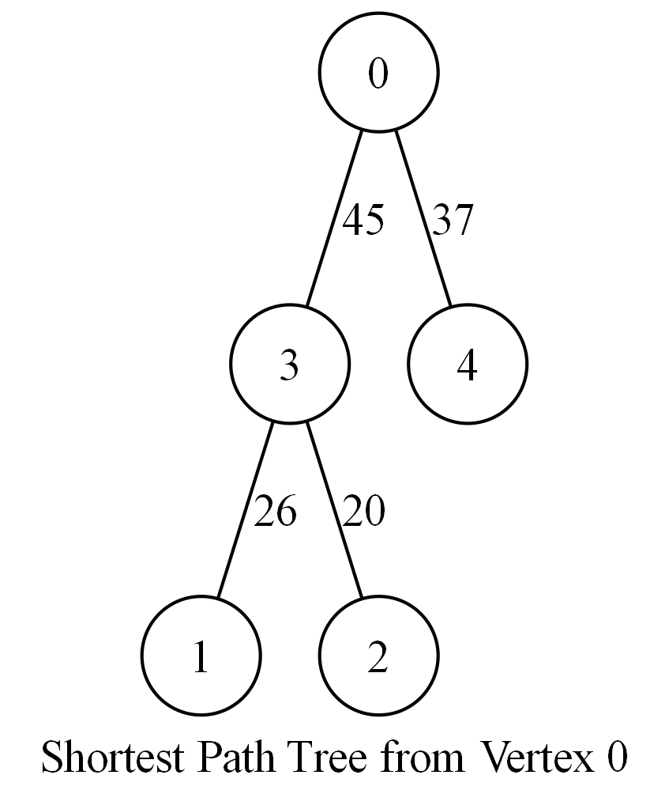
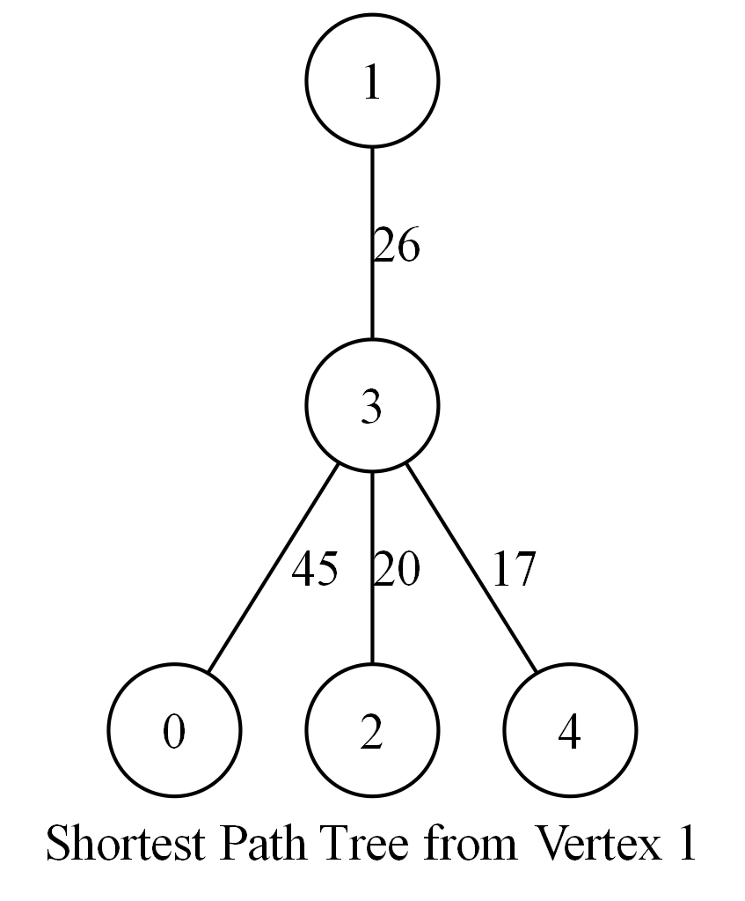
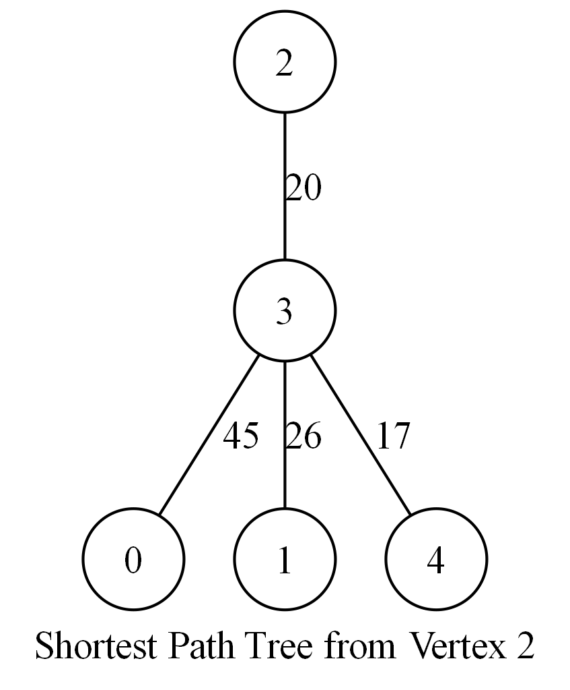
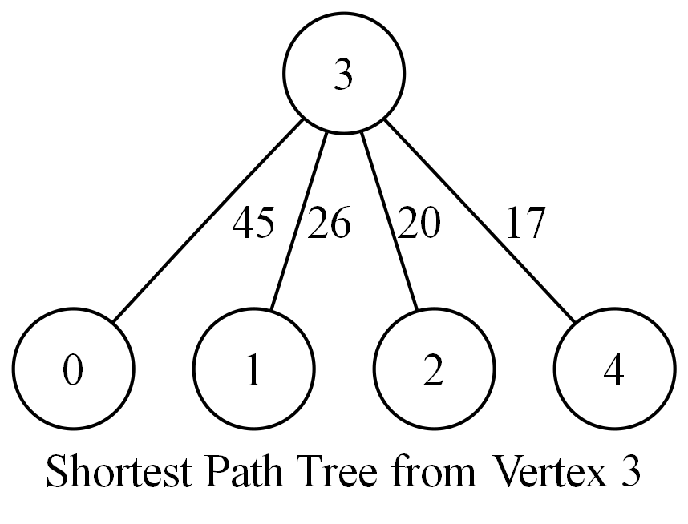
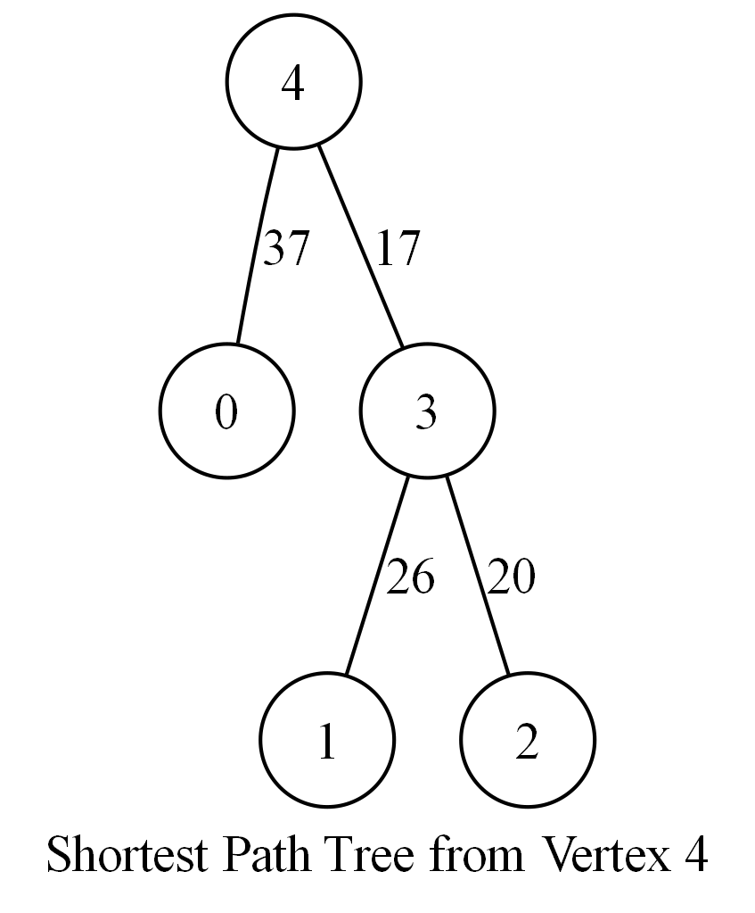

# 歷史圖形範例：5x6

[作業說明](../../README.md) · [範例總索引](../README.md)

檔名 original_graph 為原圖，shortest_path_tree_X 為 source X 的最短路徑樹。DOT 是 Graphviz 描述檔，PNG 是原課程保存的渲染圖；不保證與上層 graph.txt 或新測例為同一次生成資料。

- [original_graph.dot](original_graph.dot)
- [shortest_path_tree_0.dot](shortest_path_tree_0.dot)
- [shortest_path_tree_1.dot](shortest_path_tree_1.dot)
- [shortest_path_tree_2.dot](shortest_path_tree_2.dot)
- [shortest_path_tree_3.dot](shortest_path_tree_3.dot)
- [shortest_path_tree_4.dot](shortest_path_tree_4.dot)

## original_graph

## shortest_path_tree_0

## shortest_path_tree_1

## shortest_path_tree_2

## shortest_path_tree_3

## shortest_path_tree_4

